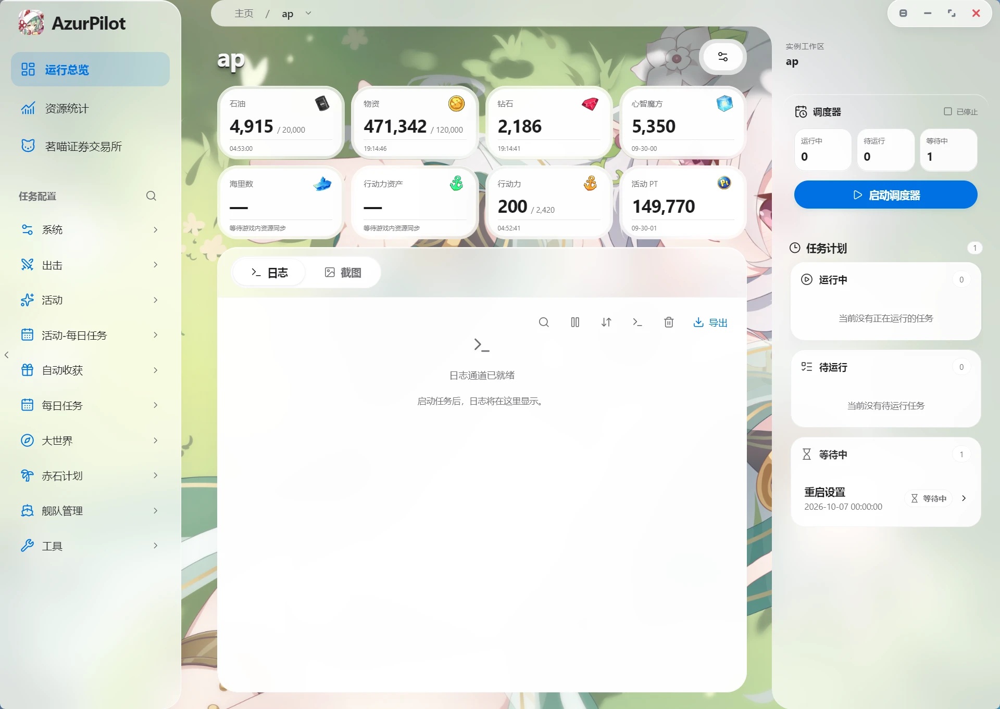
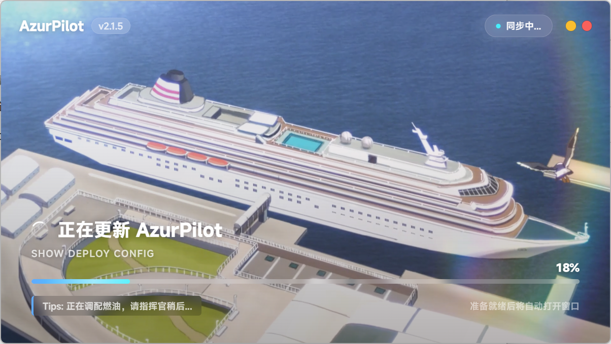
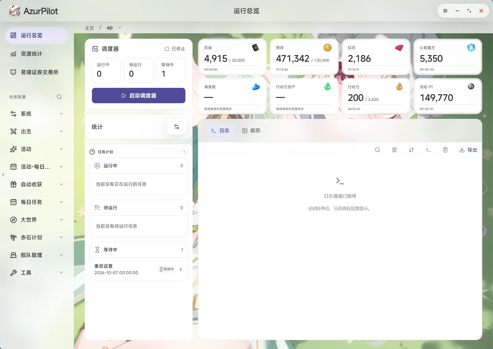
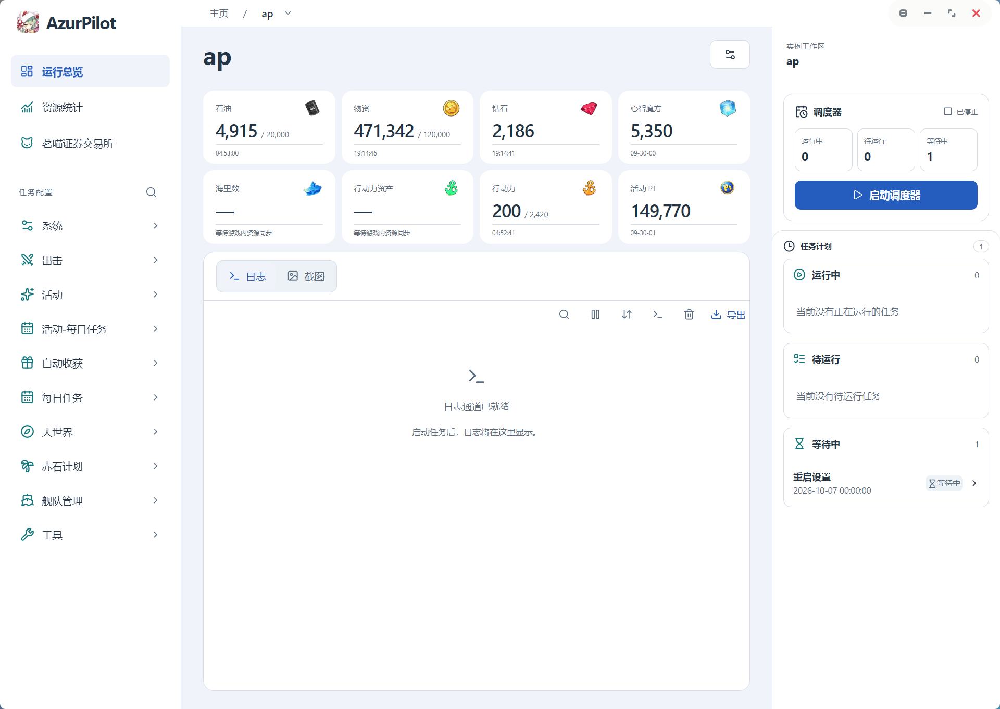
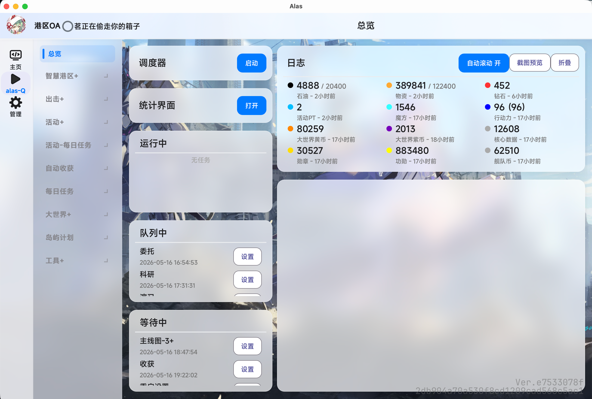

# AzurPilot — Azur Lane Automation Assistant

<p align="center">
  <a href="README.md"></a>
  <a href="README.zh-TW.md"></a>
  <a href="README.en.md"></a>
  <a href="README.ja.md"></a>
  <a href="README.ko.md"></a>
</p>

<p align="center">
  
</p>

<p align="center">
  <strong><a href="https://azurpilot.com/">AzurPilot Official Website</a></strong> ｜ Azur Lane Automation Script · OS Erosion Cycle · Multi-Platform Support
</p>

<p align="center">
  <a href="https://deepwiki.com/wess09/AzurPilot"></a>
</p>

<p align="center">
  
  
  
  
  
</p>

<p align="center">
  
  
  
  
</p>

<p align="center">
  
  
  
</p>

<div align="center">
  <a href="https://azurpilot.com/">
    
  </a>
  &nbsp;&nbsp;&nbsp;&nbsp;
  <a href="https://join.nanoda.work/#/">
    
  </a>
</div>

## Introduction

AzurPilot is an Azur Lane automation assistant modified from [AzurLaneAutoScript](https://github.com/LmeSzinc/AzurLaneAutoScript), retaining the core capabilities of the original project while integrating multiple branches, feature improvements, and experimental features. It controls Android emulators via ADB/uiautomator2, automatically executing game tasks through screenshot recognition, image matching, and OCR, with support for the CN/EN/JP/TW servers.

> **Note**: The code of this project is largely generated and assisted by AI, so there may be significant uncertainty. Pull requests to fix issues are welcome at [AzurPilot Pull Requests](https://github.com/wess09/AzurPilot/pulls).

Visit the **[AzurPilot Official Website](https://azurpilot.com/)** for more feature details, or go to the **[Download Page](https://azurpilot.com/download.html)** to get the latest version.

## GUI Preview

<div align="center">
  
</div>

## Quick Start

> 💡 **Recommended**: Download the launcher for your platform from the [AzurPilot download page](https://azurpilot.com/download.html). It bundles a Python environment and is ready to use out of the box.

### Linux One-Click Deployment

```shell
curl -fsSL https://azurpilot.com/install/deploy-image.sh | sudo -E bash
```

### Running from Source

This project uses `uv` and a project-level `.venv` to manage the Python environment (requires Python >= 3.14). The release launcher bundles uv, Python, ADB, and Git, and syncs dependencies into `.venv`. For development from source, install uv and run:

```bash
uv sync --frozen --no-dev
uv run python gui.py
```

After startup, open `http://127.0.0.1:25548` in your browser to access the WebUI.

## Important Notes

- This project contains extensive automation and image recognition functionality. Before using it, make sure you have completed the [in-game settings](#before-you-start). Otherwise, recognition may fail, workflows may behave abnormally, or tasks may not run properly.
- This project includes some experimental features that may have unknown issues. It is recommended to back up your configuration before use and report any anomalies promptly.

## Before You Start

You must modify the in-game settings according to the standards below.

Path: Main Menu → Settings (bottom right) → Options (left sidebar).

| Setting | Recommended Value |
| --- | --- |
| Frame Rate | 60 FPS |
| OS Settings, Reduce TB Guidance | On |
| OS Settings, Auto-submit items during auto mode | On |
| OS Settings, Auto mode default on in safe seas | Off |
| Story auto-play | On |
| Story auto-play speed | Extra Fast |
| Idle mode settings, enable idle mode | Off |
| Other settings, duplicate character notification | Off |
| Other settings, quick-change second confirmation dialog | Off |
| Other settings, show settlement characters | Off |

### OS (Operation Siren) Settings

Path: OS → Radar (top right) → Command Module → Submarine Support.

| Setting | Recommended Value |
| --- | --- |
| Submarine sortie when X consumes | Unchecked |

### One-Click Retirement Settings

Path: Main Menu → Build (bottom right) → Retirement (left sidebar) → Gear icon (left) → One-Click Retirement Settings.

| Setting | Recommended Value |
| --- | --- |
| Selection priority 1 | R |
| Selection priority 2 | SR |
| Selection priority 3 | N |
| When owning max-limit-break duplicates, how many eligible duplicates to keep | None |
| When not owning max-limit-break duplicates, how many eligible duplicates to keep | Enough for max LB or none |

### Image Recognition Notes

Please remove the following content that may affect recognition:

- Character equipment
- Character skins
- Custom display content that may obscure UI elements

These may affect image recognition results and cause anomalies in the automation workflow.

## MCP Service

AzurPilot provides an MCP service that can be called by MCP-compatible clients or tools, making it convenient to manage AzurPilot with an Agent.

> The MCP service starts by default with the WebUI and is mounted under the `/mcp` path (WebUI default port 25548). It can also be run standalone via `uv run python mcp_server_sse.py` (standalone port 22268).

The MCP service reuses the WebUI password (the `--key` flag or `Password` in `config/deploy.yaml`). If no password is set and the WebUI listens on a public address, it generates one automatically — see `password.txt` in the repository root. Requests without this password are rejected with 401.

### Local Connection Configuration

```json
{
  "mcpServers": {
    "alas": {
      "url": "http://127.0.0.1:25548/mcp/sse",
      "headers": {
        "Authorization": "Bearer <WebUI password>"
      }
    }
  }
}
```

### Cloud Server or Intranet Connection Configuration

```json
{
  "mcpServers": {
    "alas": {
      "url": "http://[IP_ADDRESS]:25548/mcp/sse",
      "headers": {
        "Authorization": "Bearer <WebUI password>"
      }
    }
  }
}
```

Replace `[IP_ADDRESS]` with your actual server address or intranet address. If the WebUI port has been changed, update the port in the URL accordingly.

Clients that can only specify a URL and cannot set custom headers may put the password in the query string instead: `http://[IP_ADDRESS]:25548/mcp/sse?key=<WebUI password>`. The URL itself then becomes the credential, so do not share or screenshot it, and prefer the header when possible. `X-API-Key: <WebUI password>` is also accepted in place of `Authorization`.

After changing the password, restart the WebUI so that MCP picks it up.

### MCP Tool List

The default endpoint exposes 25 `azurpilot_` tools; legacy names are available only on an explicitly created compatibility endpoint.

| Category | Tool Name | Description |
| --- | --- | --- |
| Instances | `azurpilot_list_instances` | List instances with process status and current task |
| | `azurpilot_get_context` | Compact snapshot: status, current task, schedule/resources, recent error, device capabilities |
| | `azurpilot_start_instance` / `azurpilot_stop_instance` | Start / stop the instance worker |
| Task Discovery | `azurpilot_search_tasks` | Find tasks by id, display name or parameter text; common aliases supported |
| | `azurpilot_get_task_schema` | Read parameter definitions, defaults, options and writability |
| Config & Schedule | `azurpilot_get_config` | Read config by task or path, returning a revision |
| | `azurpilot_patch_config` | Atomic batch edit with revision check and dry_run |
| | `azurpilot_set_task_schedule` | Set enable flag / next run time (scheduled ≠ completed) |
| Logs & Observation | `azurpilot_get_logs` | Read bounded logs by cursor, level and keyword |
| Statistics | `azurpilot_get_statistics` | Read metrics, timelines and tables from the statistics and overview pages: overview resources, resource trends, Operation Siren, commissions, ship EXP, drops, research, storage and resource flows |
| | `azurpilot_get_statistics_schema` | Statistics field catalog: categories, metric keys, units, meanings and filters |
| | `azurpilot_observe_device` | Capture a screenshot with frame size, orientation and timestamp |
| Device Control | `azurpilot_acquire_device_control` / `azurpilot_release_device_control` | Take over the device after stopping the scheduler; acquire/release `lease_id` (30 min TTL, renewed per call) |
| | `azurpilot_click` / `azurpilot_swipe` / `azurpilot_long_press` | Coordinate tap, swipe, long press; requires `lease_id`; reports dispatch and screen change separately |
| | `azurpilot_input_text` / `azurpilot_press_key` | Type text (no implicit Enter) or send a key event; requires `lease_id` |
| | `azurpilot_adb_shell` | Run whitelisted read-only ADB diagnostics (e.g. `wm size`, `dumpsys battery`) |
| Operation Status | `azurpilot_get_operation` | Query the final state of a write operation by operation_id |
| Maintenance | `azurpilot_restart_emulator` | Restart the emulator bound to the instance |
| | `azurpilot_restart_adb` | Restart the global ADB service |
| | `azurpilot_update_application` | Request an application update (accepted ≠ completed) |

Every tool declares `inputSchema` / `outputSchema`, returns structured results and stable error codes; write operations support `request_id` deduplication, and a timeout should be followed by `azurpilot_get_operation` rather than a blind retry. See the [MCP service documentation](docs/modules/entry/mcp-server.md).

## Multi-Platform Launcher

> 📥 Download the Windows / macOS / Linux launchers from the [AzurPilot Official Website](https://azurpilot.com/download.html)

<div align="center">
  
  <p>Loading screen</p>
  <table align="center">
    <tr>
      <td align="center"><br>New</td>
      <td align="center"><br>Legacy</td>
      <td align="center"><br>Minimal</td>
    </tr>
  </table>
  <p>Windows client UI</p>
  
  <p>macOS client UI</p>
</div>

Launcher project: [GitHub](https://github.com/wess09/alas-launcher) · Original project [ALAS Launcher: A New Type of AzurLaneAutoScript Launcher](https://github.com/swordfeng/alas-launcher)

Changes:

1. Added system tray support
2. Native Windows notifications
3. Improved GUI styling
4. Migrated to uv
...

## Contributors

Since this project continues development based on AzurLaneAutoScript and its community forks, the contributor list includes not only direct contributors to this repository but also original contributors from upstream projects and related forks.

*Contributors to this project

<a href="https://github.com/wess09/AzurPilot/graphs/contributors">
  
</a>

*Contributors to the launcher project

<a href="https://github.com/wess09/alas-launcher/graphs/contributors">
  
</a>

*Contributors to the original ALAS project

<a href="https://github.com/LmeSzinc/AzurLaneAutoScript/graphs/contributors">
  
</a>

## Related Links

- [AzurPilot Official Website](https://azurpilot.com/) — Project introduction, feature details, Azur Lane automation solutions
- [AzurPilot Download Page](https://azurpilot.com/download.html) — Download the Azur Lane script tool for Windows / macOS / Linux
- [GitHub Repository](https://github.com/wess09/AzurPilot) — Source code, Issues, Pull Requests
- [QQ Community Group](https://join.nanoda.work/#/) — Azur Lane automation community
- [AzurLaneAutoScript Upstream](https://github.com/LmeSzinc/AzurLaneAutoScript) — The original ALAS

### Derived Projects & Community Links

- [AzurPilot Raspberry Pi Edition](https://github.com/nnieie/AzurPilot) — AzurPilot CN deployment for Raspberry Pi / Termux physical devices
- [AzurPilot-private-Ru](https://github.com/AliceLiddell01/AzurPilot-private-Ru) — Personal Russian version of AzurPilot with controlled updates, transparent startup, and reduced network dependencies
- [PerseusAutoScript](https://github.com/lajiovo/PerseusAutoScript) — Comprehensive ops toolkit for AzurPilot featuring background silent execution, closed-loop self-healing, and multi-channel notifications
- [AzurRem](https://github.com/syyxl3111/AzurRem) — Native Android client for AzurPilot (rewritten in Kotlin + Jetpack Compose, with PC gateway widget)

## Development & Contribution

This project is almost entirely a product of VibeCoding, so please excuse any shortcomings. Feedback, fixes, or documentation improvements via Issue or Pull Request are welcome.

### Development Environment

```bash
uv sync --frozen        # Create/sync .venv (including dev dependencies)

# Code check (CI uses loose ruff settings — only checks for fatal syntax errors and undefined names)
uv run ruff check . --select E9,F63,F7,F82 --ignore F821,F722

# Tests (~160 unit tests)
uv run python -m unittest discover -s tests

# Config generation (must run after modifying config YAML files)
uv run -m module.config.config_updater
```

### Development Tools & Models Used

Various AI models and development tools were used during the development of this project.

**AI Models:**

| | | |
| --- | --- | --- |
| Gemini | GPT | Claude |
| GLM | MiMo | DeepSeek |
| Kimi | Qwen | DouBao |

**Development Tools:**

| | | |
| --- | --- | --- |
| Claude Code | Codex | Cursor | Antigravity |
| TRAE | ZCode | OpenCode | MiMoCode |


## License

This project follows the license requirements of the original project and related upstream projects. The launcher project is open source under the GPL-3.0 license.

The licenses of the projects this project depends on are located in /licenses.

When using, modifying, or distributing this project, please comply with the license requirements of the relevant upstream projects as well.

## Sponsorship

<p align="center">
  <a href="https://afdian.com/a/miaonaa">
    
  </a>
  <br>
  <b>Support this project (for server costs or training new models, etc.?)</b>
</p>
