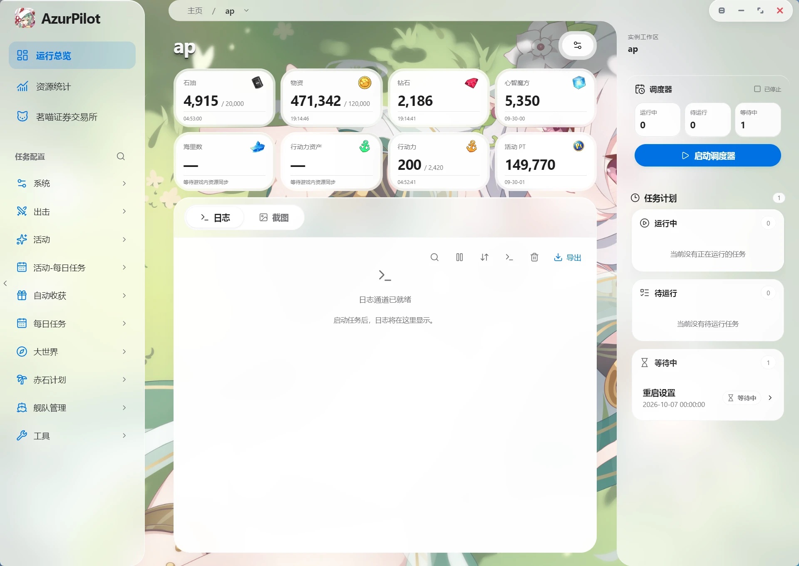
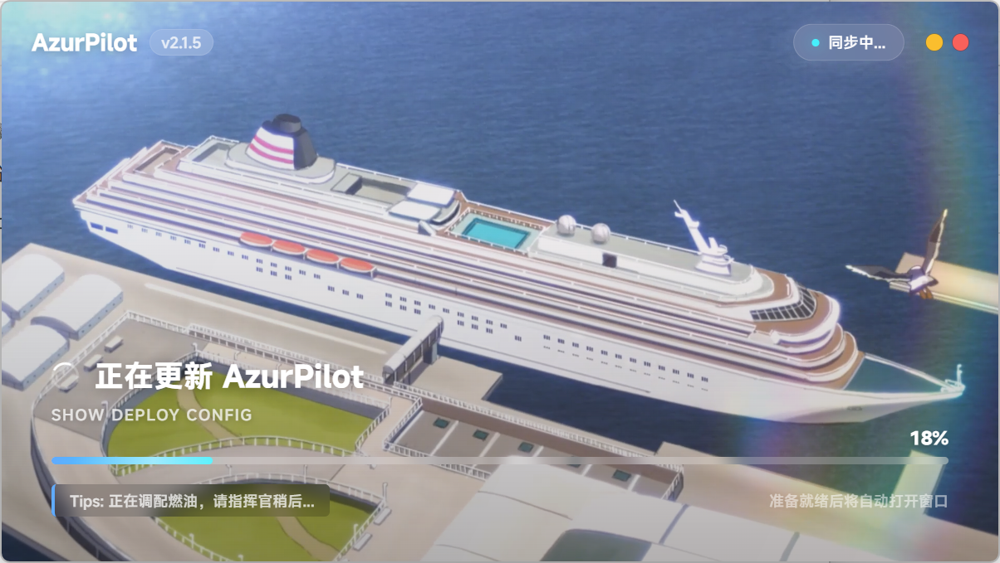
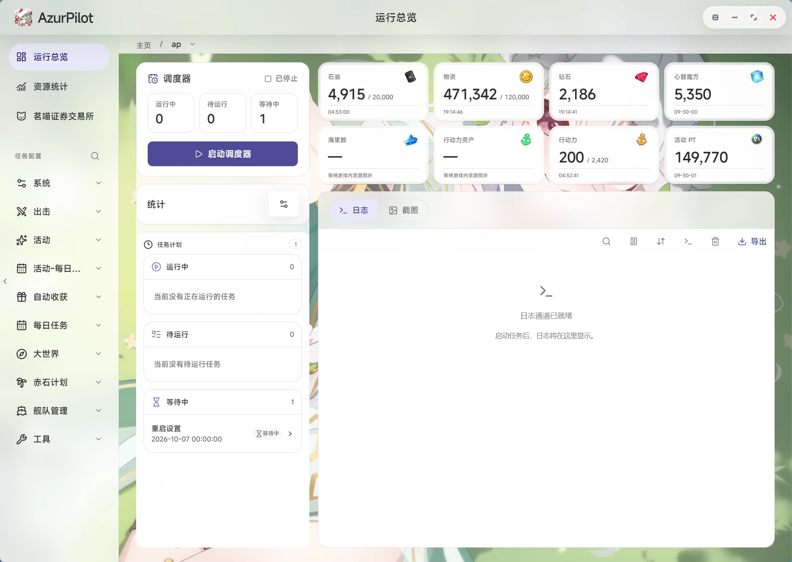
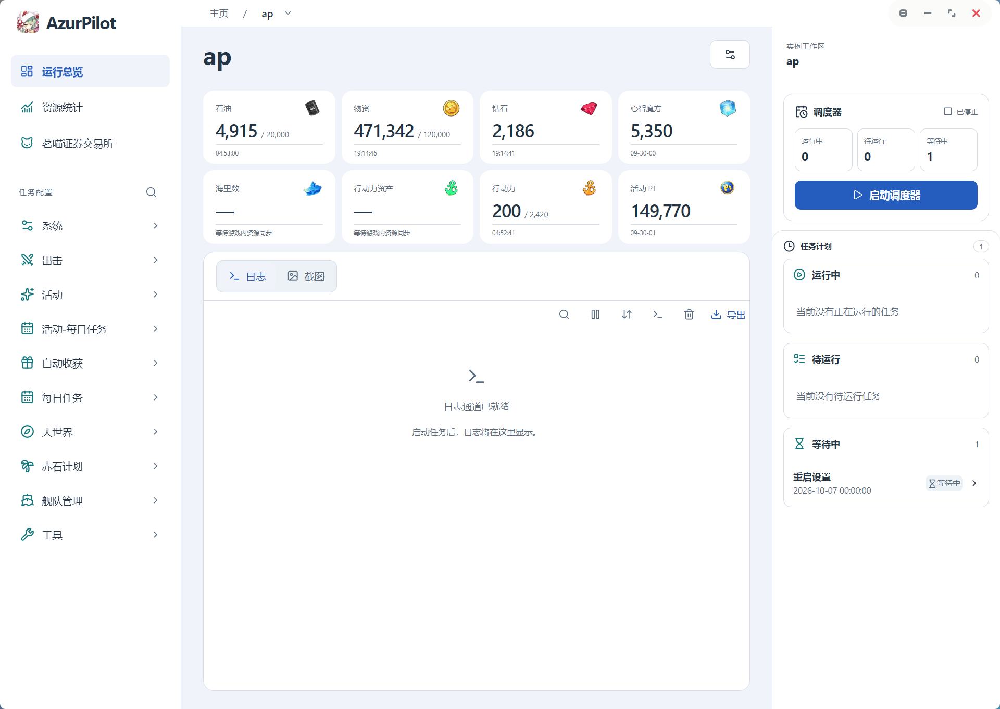
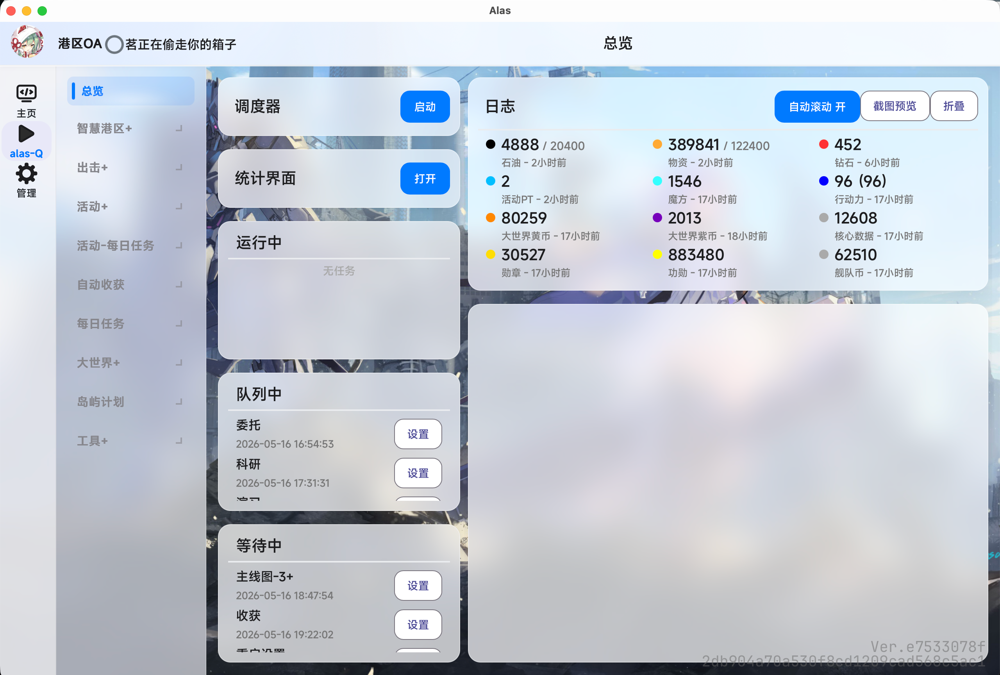

# AzurPilot — 아즈란 레인 자동화 지원 도구

<p align="center">
  <a href="README.md"></a>
  <a href="README.zh-TW.md"></a>
  <a href="README.en.md"></a>
  <a href="README.ja.md"></a>
  <a href="README.ko.md"></a>
</p>

<p align="center">
  
</p>

<p align="center">
  <strong><a href="https://azurpilot.com/">AzurPilot 공식 웹사이트</a></strong> ｜ 아즈란 레인 자동화 스크립트 · 대세계 침식 루프 · 멀티 플랫폼 지원
</p>

<p align="center">
  <a href="https://deepwiki.com/wess09/AzurPilot"></a>
</p>

<p align="center">
  
  
  
  
  
</p>

<p align="center">
  
  
  
  
</p>

<p align="center">
  
  
  
</p>

<div align="center">
  <a href="https://azurpilot.com/">
    
  </a>
  &nbsp;&nbsp;&nbsp;&nbsp;
  <a href="https://join.nanoda.work/#/">
    
  </a>
</div>

## 프로젝트 소개

AzurPilot은 [AzurLaneAutoScript](https://github.com/LmeSzinc/AzurLaneAutoScript)를 기반으로 수정된 아즈란 레인 자동화 지원 도구입니다. 원래 프로젝트의 핵심 기능을 유지하면서 여러 브랜치, 기능 개선, 실험적 기능을 통합했습니다. ADB/uiautomator2로 Android 에뮬레이터를 제어하고, 스크린샷 인식, 이미지 매칭, OCR을 통해 게임 작업을 자동 실행합니다. CN/EN/JP/TW 4개 서버를 지원합니다.

> **주의**: 이 프로젝트의 코드는 대부분 AI에 의해 생성·보조되었으며, 불확실성이 크므로 [Pull Request](https://github.com/wess09/AzurPilot/pulls)를 통한 수정을 환영합니다.

**[AzurPilot 공식 웹사이트](https://azurpilot.com/)**에서 기능에 대한 자세한 내용을 확인하거나, **[다운로드 페이지](https://azurpilot.com/download.html)**에서 최신 버전을 받으세요.

## GUI 미리보기

<div align="center">
  
</div>

## 빠른 시작

> 💡 **권장**: [AzurPilot 다운로드 페이지](https://azurpilot.com/download.html)에서 해당 플랫폼의 런처를 다운로드하세요. Python 환경이 포함되어 있어 바로 사용할 수 있습니다.

### Linux 원클릭 배포

```shell
curl -fsSL https://azurpilot.com/install/deploy-image.sh | sudo -E bash
```

### 소스 코드 실행

이 프로젝트는 `uv`와 프로젝트 루트의 `.venv`로 Python 환경을 관리합니다(Python >= 3.14 필요). 릴리스 런처에는 uv, Python, ADB, Git이 포함되어 있으며, `.venv`에 의존성을 동기화합니다. 소스에서 개발할 때는 uv를 설치한 후 실행하세요:

```bash
uv sync --frozen --no-dev
uv run python gui.py
```

시작 후 브라우저에서 `http://127.0.0.1:25548`에 접속하면 WebUI를 사용할 수 있습니다.

## 중요 안내

- 이 프로젝트에는 많은 자동화 로직과 이미지 인식 기능이 포함되어 있습니다. 사용 전에 [게임 내 설정](#사용-전-설정)이 완료되었는지 확인하세요. 완료되지 않으면 인식 실패, 프로세스 오류, 작업 실행 불가 등의 문제가 발생할 수 있습니다.
- 이 프로젝트에는 실험적 기능이 포함되어 있으며, 알 수 없는 문제가 존재할 수 있습니다. 사용 전에 설정을 백업하고, 이상을 발견하면 신속하게 피드백해 주세요.

## 사용 전 설정

사용 전에 아래 기준에 따라 게임 내 설정을 변경해야 합니다.

경로: 메인 메뉴 → 오른쪽 하단 설정 → 왼쪽 사이드바 옵션.

| 설정 이름 | 권장 값 |
| --- | --- |
| 프레임 설정 | 60 FPS |
| 대형 작전 설정, TB 안내 축소 | 켜기 |
| 대형 작전 설정, 자율 모드 중 아이템 자동 제출 | 켜기 |
| 대형 작전 설정, 안전 해역에서 자율 모드 기본 켜기 | 끄기 |
| 스토리 자동 재생 | 켜기 |
| 스토리 자동 재생 속도 조정 | 초고속 |
| 대기 모드 설정, 대기 모드 활성화 | 끄기 |
| 기타 설정, 중복 캐릭터 획득 알림 | 끄기 |
| 기타 설정, 빠른 교체 재확인 화면 | 끄기 |
| 기타 설정, 정산 캐릭터 표시 | 끄기 |

### 대형 작전 설정

경로: 대형 작전 → 오른쪽 상단 레이더 → 지휘 모듈 → 잠수함 지원.

| 설정 이름 | 권장 값 |
| --- | --- |
| X 소모 시 잠수함 출격 | 체크 해제 |

### 원클릭 퇴역 설정

경로: 메인 메뉴 → 오른쪽 하단 건조 → 왼쪽 사이드바 퇴역 → 왼쪽 톱니바퀴 아이콘 → 원클릭 퇴역 설정.

| 설정 이름 | 권장 값 |
| --- | --- |
| 선택 우선순위 1 | R |
| 선택 우선순위 2 | SR |
| 선택 우선순위 3 | N |
| 풀돌파 동명 함선 보유 시, 퇴역 조건을 충족하는 동명 함선 몇 척 보존 | 보존 안 함 |
| 풀돌파 동명 함선 미보유 시, 퇴역 조건을 충족하는 동명 함선 몇 척 보존 | 풀돌파 필요 수 또는 보존 안 함 |

### 이미지 인식 주의사항

인식에 영향을 줄 수 있는 다음 항목을 제거하세요:

- 캐릭터 장비
- 캐릭터 스킨
- UI 요소를 가릴 수 있는 사용자 정의 표시 내용

이러한 항목은 이미지 인식 결과에 영향을 주어 자동화 프로세스에 이상을 유발할 수 있습니다.

## MCP 서비스

AzurPilot은 MCP 서비스를 제공하며, MCP 호환 클라이언트나 도구에서 호출하여 Agent로 AzurPilot을 쉽게 관리할 수 있습니다.

> MCP 서비스는 기본적으로 WebUI와 함께 시작되며 `/mcp` 경로(WebUI 기본 포트 25548)에 마운트됩니다. 또한 `uv run python mcp_server_sse.py`로 단독 실행할 수도 있습니다(단독 포트 22268).

MCP는 WebUI 비밀번호(`--key` 또는 `config/deploy.yaml`의 `Password`)를 그대로 사용합니다. 비밀번호가 없고 WebUI가 공용 주소를 수신하면 WebUI가 자동으로 생성하며, 저장소 루트의 `password.txt`에서 확인할 수 있습니다. 이 비밀번호가 없는 요청은 401로 거부됩니다.

### 로컬 연결 설정

```json
{
  "mcpServers": {
    "alas": {
      "url": "http://127.0.0.1:25548/mcp/sse",
      "headers": {
        "Authorization": "Bearer <WebUI 비밀번호>"
      }
    }
  }
}
```

### 클라우드 서버 또는 인트라넷 연결 설정

```json
{
  "mcpServers": {
    "alas": {
      "url": "http://[IP_ADDRESS]:25548/mcp/sse",
      "headers": {
        "Authorization": "Bearer <WebUI 비밀번호>"
      }
    }
  }
}
```

`[IP_ADDRESS]`를 실제 서버 주소 또는 인트라넷 주소로 바꾸세요. WebUI 포트를 변경한 경우 URL의 포트도 함께 변경하세요.

URL만 입력할 수 있고 요청 헤더를 설정할 수 없는 클라이언트는 비밀번호를 쿼리 파라미터에 넣을 수 있습니다: `http://[IP_ADDRESS]:25548/mcp/sse?key=<WebUI 비밀번호>`. 이 경우 URL 자체가 자격 증명이므로 캡처하거나 공유하지 말고, 가능하면 헤더를 사용하세요. `Authorization` 대신 `X-API-Key: <WebUI 비밀번호>`도 사용할 수 있습니다.

비밀번호를 변경한 경우 MCP에 반영되도록 WebUI를 다시 시작하세요.

### MCP 도구 목록

기본 엔드포인트는 25개의 `azurpilot_` 도구를 제공하며, 이전 도구 이름은 명시적으로 만든 호환 엔드포인트에서만 사용할 수 있습니다.

| 카테고리 | 도구 이름 | 기능 |
| --- | --- | --- |
| 인스턴스 관리 | `azurpilot_list_instances` | 인스턴스와 프로세스 상태, 현재 작업 나열 |
| | `azurpilot_get_context` | 상태, 현재 작업, 일정/리소스 요약, 최근 오류, 기기 기능을 한 번에 조회 |
| | `azurpilot_start_instance` / `azurpilot_stop_instance` | 인스턴스 시작 / 중지 |
| 작업 탐색 | `azurpilot_search_tasks` | 작업 ID, 표시 이름, 인자 문구로 검색하며 일반적인 구어 별칭 지원 |
| | `azurpilot_get_task_schema` | 매개변수 정의, 기본값, 선택지, 쓰기 가능 여부 조회 |
| 설정 및 일정 | `azurpilot_get_config` | 작업 또는 경로 단위로 설정을 읽고 revision 반환 |
| | `azurpilot_patch_config` | revision 검증을 포함한 원자적 일괄 수정, dry_run 지원 |
| | `azurpilot_set_task_schedule` | 활성 상태와 다음 실행 시각 설정(예약 ≠ 완료) |
| 로그 및 관찰 | `azurpilot_get_logs` | 커서·레벨·키워드로 제한된 로그 조회 |
| 통계 | `azurpilot_get_statistics` | 통계 및 개요 페이지의 지표·시계열·표 조회(개요 자원, 자원 추세, 세이렌 작전, 의뢰, 함선 경험치, 드롭, 연구, 창고, 자원 흐름) |
| | `azurpilot_get_statistics_schema` | 통계 필드 목록: 분류, 지표 키, 단위, 설명, 필터 |
| | `azurpilot_observe_device` | 스크린샷과 프레임 크기·방향·캡처 시각 조회 |
| 기기 제어 | `azurpilot_acquire_device_control` / `azurpilot_release_device_control` | 스케줄러 중지 후 기기를 인계받고 `lease_id` 획득/해제 (기본 30분, 호출마다 갱신) |
| | `azurpilot_click` / `azurpilot_swipe` / `azurpilot_long_press` | 좌표 탭, 스와이프, 길게 누르기. `lease_id` 필요, 명령 전송과 화면 변화를 따로 반환 |
| | `azurpilot_input_text` / `azurpilot_press_key` | 텍스트 입력(자동 확인 없음)과 키 전송. `lease_id` 필요 |
| | `azurpilot_adb_shell` | 화이트리스트의 읽기 전용 ADB 진단 명령 실행 (`wm size`, `dumpsys battery` 등) |
| 작업 확인 | `azurpilot_get_operation` | operation_id로 쓰기 작업의 최종 상태 조회 |
| 유지보수 도구 | `azurpilot_restart_emulator` | 인스턴스에 연결된 에뮬레이터 재시작 |
| | `azurpilot_restart_adb` | 전역 ADB 서비스 재시작 |
| | `azurpilot_update_application` | 애플리케이션 업데이트 요청(접수 ≠ 완료) |

모든 도구는 `inputSchema` / `outputSchema`, 구조화된 결과, 안정적인 오류 코드를 제공합니다. 쓰기 작업은 `request_id`로 중복을 방지하며, 시간 초과 시 재전송 대신 `azurpilot_get_operation`으로 확인하세요. 자세한 내용은 [MCP 서비스 문서](docs/modules/entry/mcp-server.md).

## 멀티 플랫폼 런처

> 📥 [AzurPilot 공식 웹사이트](https://azurpilot.com/download.html)에서 Windows / macOS / Linux 런처 다운로드

<div align="center">
  
  <p>로딩 화면</p>
  <table align="center">
    <tr>
      <td align="center"><br>신버전</td>
      <td align="center"><br>구버전</td>
      <td align="center"><br>심플</td>
    </tr>
  </table>
  <p>Windows 클라이언트 화면</p>
  
  <p>Mac 클라이언트 화면</p>
</div>

런처 프로젝트: [GitHub](https://github.com/wess09/alas-launcher) · 원본 프로젝트 [ALAS Launcher: 새로운 유형의 AzurLaneAutoScript 런처](https://github.com/swordfeng/alas-launcher)

변경 내용:

1. 시스템 트레이 지원 추가
2. Windows 네이티브 알림
3. GUI 스타일 개선
4. uv 전환
...

## 기여자

이 프로젝트는 AzurLaneAutoScript와 커뮤니티 포크를 기반으로 계속 개발되고 있으므로, 기여자 목록에는 이 저장소의 직접 기여자뿐만 아니라 업스트림 프로젝트와 관련 포크의 원작자도 포함됩니다.

*이 프로젝트의 기여자 목록

<a href="https://github.com/wess09/AzurPilot/graphs/contributors">
  
</a>

*런처 프로젝트의 기여자 목록

<a href="https://github.com/wess09/alas-launcher/graphs/contributors">
  
</a>

*ALAS 원본 프로젝트의 기여자 목록

<a href="https://github.com/LmeSzinc/AzurLaneAutoScript/graphs/contributors">
  
</a>

## 관련 링크

- [AzurPilot 공식 웹사이트](https://azurpilot.com/) — 프로젝트 소개, 기능 상세, 아즈란 레인 자동화 솔루션
- [AzurPilot 다운로드 페이지](https://azurpilot.com/download.html) — Windows / macOS / Linux용 아즈란 레인 스크립트 도구 다운로드
- [GitHub 저장소](https://github.com/wess09/AzurPilot) — 소스 코드, Issue, Pull Request
- [QQ 커뮤니티](https://join.nanoda.work/#/) — 아즈란 레인 자동화 커뮤니티
- [AzurLaneAutoScript 업스트림 프로젝트](https://github.com/LmeSzinc/AzurLaneAutoScript) — ALAS 오리지널

### 파생 프로젝트 및 링크

- [AzurPilot 라즈베리파이 버전](https://github.com/nnieie/AzurPilot) — 라즈베리파이 / Termux 실기기용 AzurPilot CN 배포판
- [AzurPilot-private-Ru](https://github.com/AliceLiddell01/AzurPilot-private-Ru) — 제어 가능한 업데이트, 투명한 실행 및 외부 네트워크 의존성을 줄인 개인용 러시아어 버전 AzurPilot
- [PerseusAutoScript](https://github.com/lajiovo/PerseusAutoScript) — 백그라운드 무인 제어, 폐루프 자가 치유 및 다중 알림을 지원하는 AzurPilot 종합 운영 툴킷
- [AzurRem](https://github.com/syyxl3111/AzurRem) — AzurPilot 용 네이티브 안드로이드 클라이언트 (Kotlin + Jetpack Compose 재작성, PC 게이트웨이 포함)

## 개발 및 기여

이 프로젝트는 거의 완전히 VibeCoding의 산물이므로 부족한 점이 있으면 양해 부탁드립니다. Issue나 Pull Request를 통한 피드백, 수정, 문서 개선을 환영합니다.

### 개발 환경

```bash
uv sync --frozen        # .venv 생성/동기화(개발 의존성 포함)

# 코드 검사(CI는 ruff 느슨한 설정 사용 — 치명적 문법 오류와 미정의 이름만 검사)
uv run ruff check . --select E9,F63,F7,F82 --ignore F821,F722

# 테스트(약 160개 유닛 테스트)
uv run python -m unittest discover -s tests

# 설정 생성(설정 YAML 파일 수정 후 반드시 실행)
uv run -m module.config.config_updater
```

### 사용된 개발 도구와 모델

이 프로젝트 개발 과정에서 다양한 AI 모델과 개발 도구를 사용했습니다.

**AI 모델:**

| | | |
| --- | --- | --- |
| Gemini | GPT | Claude |
| GLM | MiMo | DeepSeek |
| Kimi | Qwen | DouBao |

**개발 도구:**

| | | |
| --- | --- | --- |
| Claude Code | Codex | Cursor | Antigravity |
| TRAE | ZCode | OpenCode | MiMoCode |


## 라이선스

이 프로젝트는 원본 프로젝트 및 관련 업스트림 프로젝트의 라이선스 요구 사항을 따릅니다. 런처 프로젝트는 GPL-3.0 라이선스로 오픈소스화되어 있습니다.

이 프로젝트가 의존하는 관련 프로젝트의 라이선스는 /licenses에 있습니다.

이 프로젝트를 사용, 수정, 배포할 때는 관련 업스트림 프로젝트의 라이선스 요구 사항도 함께 준수하세요.

## 후원

<p align="center">
  <a href="https://afdian.com/a/miaonaa">
    
  </a>
  <br>
  <b>이 프로젝트 후원(서버 비용 또는 새 모델 훈련 등에 사용)</b>
</p>
