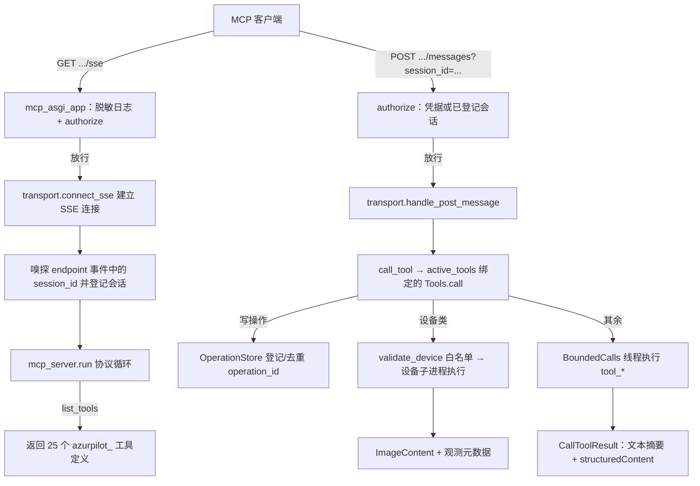
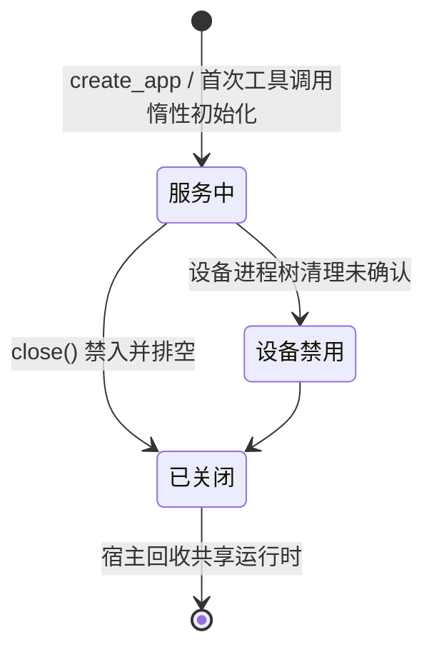
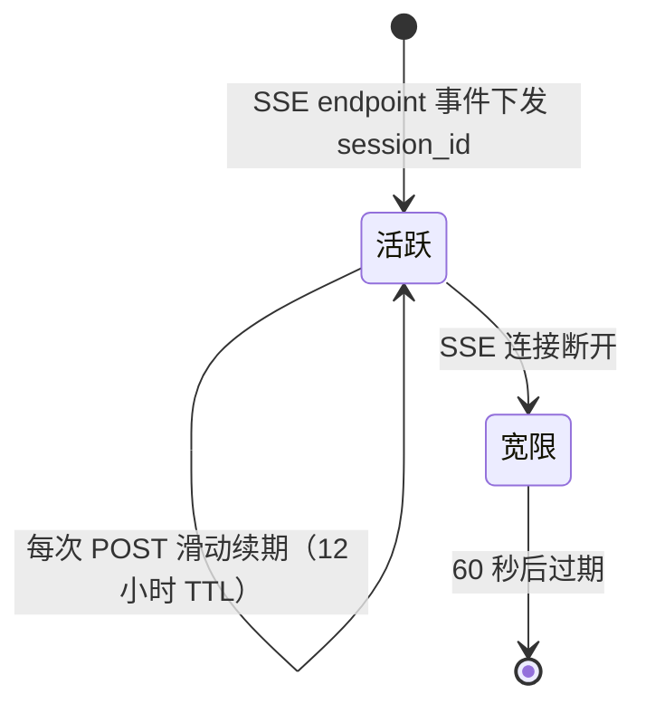
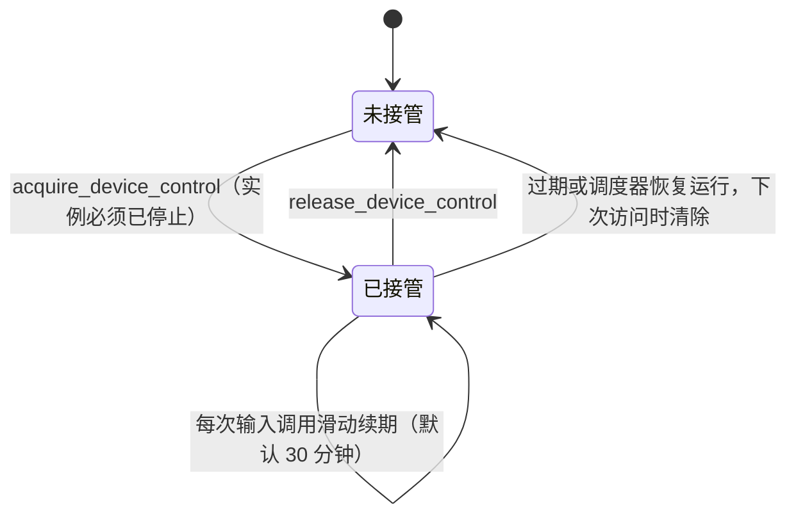

# MCP SSE 服务器（mcp_server_sse.py）

> 把实例查询、配置修改、调度控制、设备操作与统计读取共 25 个 `azurpilot_` 工具通过 MCP 协议（SSE 传输）暴露给外部 AI 助手，支持独立进程与挂载进 WebUI 两种运行方式；旧工具名只保留在显式兼容入口。

## 1. 模块概述

AzurPilot 的常规操作界面是 WebUI，但用户越来越倾向于让 AI 助手（如 Claude）代替自己观察和操作自动化框架。MCP（Model Context Protocol）是这类助手的标准接入协议，本模块就是协议适配层：对外提供一个标准 MCP 服务器，对内把工具调用翻译成对配置服务、运行时服务的读写。

这个模块存在三个设计动因：

- **AI 需要的是「语义级」接口，不是 HTTP 接口的翻译**。WebUI 的 REST/WS 接口面向前端（revision、schema、会话状态），而 MCP 客户端需要「当前在跑什么任务」「帮我立刻触发一次日常」这类以实例为中心的高层操作。工具是按 AI 使用场景重新设计的门面，不是 API 的镜像。
- **AI 需要可验证的调用闭环**：工具同时返回 `structuredContent`、简短文本摘要和 `isError`；错误带稳定代码、是否可重试、结果是否确定和下一步查询建议。写操作支持 `revision`、`request_id` 与 `operation_id`，超时后先查 `azurpilot_get_operation`，不能盲目重放。
- **破坏性操作直接暴露在 HTTP 上**：`azurpilot_stop_instance`、`azurpilot_patch_config`、`azurpilot_update_application`（git pull + 依赖同步）都含在工具集里。WebUI 的密码校验发生在 PyWebIO/网关会话内部，管不到挂载进来的 ASGI 子应用，所以鉴权单独做了一层（`module/runtime/mcp_auth.py`），密码复用 WebUI 密码而不引入第二把密钥。
- **进程要轻**：独立 MCP 进程只做协议、鉴权与分发，OCR、界面等重依赖被 CI 守卫禁止进入该进程（见 `tests/test_ci_import.py` 的进程隔离守卫）；设备操作连设备库都不在服务进程加载，而是 spawn 到子进程执行。

在系统中的位置：MCP 是与 WebUI 并列的第二个对外服务。挂载模式下它是 `module/api/app.py` 创建的 Starlette 应用挂在 `/mcp` 路径下的子应用，与 WebUI 共享同一份 `ConfigService`/`RuntimeService`；独立模式下（`uv run python mcp_server_sse.py`）它自己监听 22268 端口并拥有共享状态。两种模式最终都作用于同一批实例进程（`module/runtime`）。

所有运行入口在业务 worker 启动前执行 `module.persistence.database.initialize()`。首次迁移先备份、转换与检查，失败停止启动并保留旧源；总库完成标记存在而数据库丢失时必须恢复备份。模块导入不创建总库，详见 [普通业务数据存储](../infra/persistence.md)。

## 2. 模块职责

### 负责

- MCP 工具的单一注册表（`module/mcp/registry.py`：名称、描述、输入/输出 Schema、注解、旧名称映射）与调用分发。
- SSE 传输：`/sse` 长连接建立、`/messages` POST 投递、会话 ID 嗅探与登记。
- 鉴权挂接：从 WebUI 密码体系取得凭据，交由 `module/runtime/mcp_auth.py` 判定；请求日志脱敏。
- 工具执行的并发控制（执行槽）、超时控制、设备操作的子进程隔离与进程树回收。
- 写操作的去重台账：`request_id` 与参数指纹映射到 `operation_id`，供重试与 `azurpilot_get_operation` 查询。
- 独立模式下的密码解析（复用 WebUI 自动生成规则）与共享状态（`State`）的创建/回收。
- 服务关闭时排空在途调用、清理失败设备进程。

### 不负责

- 配置读写与校验规则：全部委托 `module/api/config_service.py`（白名单、类型校验、事务写盘均在彼处）。
- 实例进程的创建与管理：经 `RuntimeService` → `ProcessManager` 完成，MCP 不直接 fork worker。
- 更新的实际执行：`azurpilot_update_application` 只触发 `module/api/update_service.py`，git 操作与重启编排属于 `module/runtime/updater.py`。
- 设备操作的具体实现：`module/mcp/device_worker.py` 在子进程内加载 `module.device`，服务进程不碰设备库。
- 游戏逻辑、OCR、WebUI 页面与 `/api/v1/ws` 业务通信。

## 3. 模块位置

```
mcp_server_sse.py              # ASGI 应用、SSE 传输、工具目录入口、独立模式入口
module/mcp/
├── __init__.py                # 仅声明边界：MCP 协议适配，不拥有 WebUI 业务服务
├── registry.py                # 单一工具注册表：新名称、Schema、注解、旧名称映射
├── tools.py                   # Tools：统一校验、分发、操作去重与结构化结果
├── execution.py               # BoundedCalls 有限并发；设备子进程运行与超时回收
├── device_worker.py           # 设备子进程入口：截图 / 重启模拟器 / 重启 ADB
└── lifecycle.py               # 独立模式 lifespan：State 初始化与退出清理
module/runtime/mcp_auth.py     # 鉴权：凭据提取、常数时间比对、会话登记、日志脱敏
```

| 文件 | 作用 |
| --- | --- |
| `mcp_server_sse.py` | MCP ASGI 应用与传输层；`configure_auth` 注入密码；`__main__` 为独立入口 |
| `module/mcp/registry.py` | 25 个新工具 + 18 个旧名称的集中注册；默认端点只取新名称 |
| `module/mcp/tools.py` | `Tools` 类：输入校验、旧名称适配、操作台账、错误信封与分发 |
| `module/mcp/execution.py` | `BoundedCalls` 并发槽；`run_device` spawn 子进程并按超时回收进程树 |
| `module/mcp/device_worker.py` | 子进程侧执行体：截图、重启模拟器、重启 ADB |
| `module/mcp/lifecycle.py` | 独立模式的 `lifespan`：仅在自己创建共享状态时负责初始化与清理 |
| `module/runtime/mcp_auth.py` | 纯标准库实现：`authorize` 集中判定、会话表、日志脱敏过滤器 |

## 4. 核心入口

| 入口 | 用途 |
| --- | --- |
| `uv run python mcp_server_sse.py` | 独立模式：解析密码 → `configure_auth` → uvicorn 监听 `0.0.0.0:22268` |
| `module.api.app.create_app()`（`mount_mcp=True`） | 挂载模式：WebUI 工厂在挂载前调用 `configure_auth(password, public_bind=bool(password))`，再把 `create_mcp_app(configs, runtime, manage_runtime=False)` 挂到 `/mcp` |
| `mcp_server_sse.configure_auth(key, public_bind)` | 注入访问密码并安装 uvicorn access log 脱敏过滤器 |
| `mcp_server_sse.create_legacy_app(...)` | 显式旧名称兼容入口；追加已弃用工具名，新部署默认不挂载 |
| `GET <base>/sse` + `POST <base>/mcp/messages` | MCP 客户端的实际传输端点（`<base>` 挂载模式为 `/mcp`，独立模式为服务根） |
| `Tools.call(name, arguments)` | `call_tool` 的落点，所有工具执行从这里分发 |
| `Tools.close()` | 关闭入口：两组执行槽禁入并排空，再清理失败设备进程；挂载模式由宿主 lifespan 调用 |

追代码建议从 `mcp_asgi_app`（一次请求的完整路径）与 `module/mcp/tools.py` 的 `dispatch`（一次工具调用的路径）两处开始。

## 5. 核心组件

### Tools（module/mcp/tools.py）

工具执行的中枢。`call()` 依次完成：旧名称解析 → 按 `inputSchema` 校验（拒绝未知字段并返回可纠正错误）→ 兼容入参适配 → 写操作登记/去重 → 设备子进程或 `BoundedCalls` 执行 → 生成 `CallToolResult`。成功结果包含 `structuredContent` 与简短文本；失败结果置 `isError=true`，错误对象固定为 `code / message / retryable / outcome_certain`，必要时附 `details` 与 `next_step`。

| 字段 | 类型 | 说明 |
| --- | --- | --- |
| `configs` | `ConfigService` | 配置读写；惰性创建，挂载模式复用宿主实例 |
| `runtime` | `RuntimeService` | 实例状态、总览与启停；惰性创建 |
| `calls` | `BoundedCalls(limit=4)` | 普通工具执行槽，默认 90 秒超时 |
| `devices` | `BoundedCalls(limit=2)` | 设备工具执行槽；失败后整体禁入 |
| `operations` | `OperationStore` | 进程内操作台账：request_id 指纹去重、终态与错误 |
| `leases` | dict | 设备租约（实例 → `lease_id` / TTL）；只存在于服务进程内存，重启即失效 |
| `failed_devices` | list | 清理未确认的设备子进程句柄，关闭时兜底回收 |

`initialize()` 在执行线程里惰性构建上述服务（持锁、只做一次）：不在导入期加载用户配置，是「独立 MCP 进程保持轻量」的关键。

### OperationStore（module/mcp/tools.py）

写操作先获得 32 位 `operation_id`；带 `request_id` 的调用把（工具、实例、request_id、参数指纹）作为去重键。重试同参数返回同一操作（`deduplicated=true`），重试不同参数返回 `REQUEST_ID_CONFLICT`。超时错误 `outcome_certain=false`，操作保持 pending，建议先用 `azurpilot_get_operation`；普通失败会记录稳定错误。台账容量 256，按插入顺序淘汰，重启后不可查询。

### BoundedCalls（module/mcp/execution.py）

有限并发执行器。同步工具在线程中执行，asyncio 侧的超时或客户端取消**不会**取消已交付线程的真实工作（`asyncio.shield` + 槽位保留到工作结束），因此超时响应的语义是「操作可能仍在完成」，客户端应查询状态而非盲目重试。关闭时先禁入再排空，保证清理共享状态后不会再有启动操作落地。

### 设备子进程（run_device / device_worker）

`azurpilot_observe_device`、坐标与输入类工具（`azurpilot_click` / `azurpilot_swipe` / `azurpilot_long_press` / `azurpilot_input_text` / `azurpilot_press_key` / `azurpilot_adb_shell`）、`azurpilot_restart_emulator`、`azurpilot_restart_adb` 在 spawn 子进程中执行，结果经临时目录里的 JSON 文件回传。截图返回 `ImageContent`，同时给结构化观测元数据：`frame_id`、宽高、方向、UTC 采集时间、是否缓存帧和截图后端；输入类操作额外回传操作前后的帧差异（`frame_changed` / `frame_difference`），把「命令已下发」与「画面已变化」分开陈述。设计原因：设备库可能无限重试，只有进程级硬超时（join 后回收整棵进程树）能保证服务不被拖死；同时隔离 `ALAS_CONFIG_NAME` 等环境变量污染与重型导入。清理无法确认退出时抛 `DeviceCleanupError` 并禁用设备工具直到重启。

### mcp_auth（module/runtime/mcp_auth.py）

只依赖标准库的鉴权模块（可独立单测、不拖入 WebUI/OCR 依赖链）。所有判定集中在 `authorize()`，ASGI 层只做转发：非 MCP 端点不拦、方法不对返回 405、「公网 + 无密码」返回 503、凭据错误返回 401、`/messages` 还可用已登记的 session_id 放行。

### 工具注册表（module/mcp/registry.py）

`TOOL_REGISTRY` 固定顺序登记 25 个新工具，每个条目包含描述（何时用、前置条件、返回什么、如何确认完成）、`inputSchema`（拒绝未知字段）、`outputSchema` 与 `readOnlyHint / destructiveHint / idempotentHint` 注解。`LEGACY_REGISTRY` 集中维护 18 个旧名称到新工具的映射和入参适配；默认 `tool_definitions()` 只返回新名称，`allow_legacy=True` 才追加兼容目录。

### 工具清单（25 个）

| 分组 | 工具 | 用途 |
| --- | --- | --- |
| 管理/查询 | `azurpilot_list_instances` | 实例名、进程状态与当前任务 |
| 实例上下文 | `azurpilot_get_context` | 运行状态、当前任务、计划摘要、资源、最近错误、设备能力 |
| 任务发现 | `azurpilot_search_tasks` / `azurpilot_get_task_schema` | 按任务标识、中文显示名、参数组、参数/选项文案搜索（含常见口语别名）；读取参数路径、默认值、可选值、可写性 |
| 配置 | `azurpilot_get_config` / `azurpilot_patch_config` | 按 revision 读取；原子批量修改，支持 dry_run，返回前后值 |
| 调度 | `azurpilot_set_task_schedule` | 设置任务启用与 NextRun；返回 scheduled/running，不谎报任务完成 |
| 日志 | `azurpilot_get_logs` | 按游标、级别、关键词读取有限日志 |
| 统计数据 | `azurpilot_get_statistics` | 读取统计页与概览页数据：10 个分类，返回指标键、数值、单位、口径说明、时间线与表格 |
| | `azurpilot_get_statistics_schema` | 统计字段目录：分类、指标键、时间线单位、表格列与筛选参数含义；不需要实例 |
| 设备观测 | `azurpilot_observe_device` | 主动截图 + 帧元数据 |
| 设备控制 | `azurpilot_acquire_device_control` / `azurpilot_release_device_control` | 调度器停止后接管设备，取得/释放 `lease_id`（默认 30 分钟，调用续期） |
| | `azurpilot_click` / `azurpilot_swipe` / `azurpilot_long_press` | 坐标点击、滑动、长按；需 `lease_id`，返回命令下发与画面变化两个事实 |
| | `azurpilot_input_text` / `azurpilot_press_key` | 输入文本（不自动回车）、发送按键；需 `lease_id` |
| | `azurpilot_adb_shell` | 执行白名单内的只读 ADB 诊断命令（如 `wm size`、`dumpsys battery`） |
| 操作查询 | `azurpilot_get_operation` | 按 operation_id 查询写操作终态 |
| 实例生命周期 | `azurpilot_start_instance` / `azurpilot_stop_instance` | 启动/确认停止实例进程 |
| 设备维护 | `azurpilot_restart_emulator` / `azurpilot_restart_adb` | 重启实例模拟器 / 全局 ADB |
| 应用更新 | `azurpilot_update_application` | 请求后台更新；accepted≠completed，终态走 operation |

### 统计数据（azurpilot_get_statistics）

`category` 与 WebUI 分类一一对应：`overview`（概览资源卡片）、`resources`、`action`、`opsi`、`commission`、`ships`、`loot`、`research`、`storage`、`flows`（资源流向/资源管理页）。数据直接复用 `module/api/statistics_service.py` 与 `module/api/resource_service.py`，不在这里重算口径；报表里的 `columns` 与界面列名一致。

统一返回结构：

| 字段 | 说明 |
| --- | --- |
| `metrics[]` | `key`（稳定机读键）、`label`（界面显示名）、`value`、`unit`、`meaning`（口径说明）、`icon` |
| `series[]` | `key`、`label`、`unit`、`meaning`、`point_count`、`truncated`、`points[]{time,value,source}`；`max_points` 超过时等距抽样，只抽真实点，不聚合、不补零 |
| `tables[]` | `key`、`title`、`meaning`、`columns`（界面列名）、`column_keys`（等长机读列键）、`rows`（按列键顺序的数组）、`note` |
| `resources[]` | `overview` / `flows` 专用：概览卡片含 `value/limit/total/record/observed`，资源流向含 `group/income/expense/adjustment/records/observed_at` |
| `state` | `ready` / `empty` / `loading`；`empty` 与 `loading` 都附带 `hint`，`loading` 表示仓库扫描进行中、返回的是上次完整快照 |
| 其它 | `window`（月份/周期/区间）、`notes[]`、`task_options[]`、`page{}`、`truncated`、`generated_at`、`data_source` |

`azurpilot_get_statistics_schema` 返回同一套字段的目录，包括当前数据里尚未出现的固定指标键、动态指标规则（`item:` / `resource:`）与错误码说明；生成报表前先调用它可避免猜中文名。

筛选参数按分类白名单校验，跨分类传参会直接报 `INVALID_PARAMS` 并给出 `details.field`，不会静默忽略。`loot` 与 `flows` 的 `task` 省略或留空表示全部任务（对应界面上的「全部大世界任务」）；`research` 的 `series=0` 表示最新有记录的一期。`flows` 的 `offset`/`limit` 只分页流水明细，`page` 给出 `total` 与 `has_more`。

无数据、加载中与权限不足分别处理：所选区间没有记录时返回成功 + `state=empty` + `hint`（不当作错误，避免 AI 反复重试）；统计库被写入锁住返回 `STATISTICS_LOADING`（`retryable=true`）；库不可读返回 `STATISTICS_UNAVAILABLE`；文件权限不足返回 `PERMISSION_DENIED`；缺少或错误凭据在 SSE 端点直接 401，工具不会执行。

兼容映射包括 `list_instances → azurpilot_list_instances`、`get_status/get_resources/get_current_running_task/get_scheduler_queue → azurpilot_get_context`、`get_screenshot → azurpilot_observe_device`、`list_tasks → azurpilot_search_tasks`、`get_task_help → azurpilot_get_task_schema`、`update_config → azurpilot_patch_config`、`trigger_task → azurpilot_set_task_schedule`、`update_alas → azurpilot_update_application`。`clear_scheduler_queue` 因会批量禁用多项任务，不在新默认目录中，仅保留在兼容入口。

**契约范围**：第 1 个 PR 统一的是现有能力的命名、参数与返回；设备控制能力组（租约 + 点击/滑动/输入）已包含在本轮工具集中。实例端点绑定（免传 `instance`）、管理端生命周期扩展（`create_instance` / `delete_instance` / `restart_instance` / `get_instance_config_schema`）、`get_events` / `get_error_context`、MCP Resource 与订阅，分别在后续 PR 按同一注册表追加。当前所有实例类工具仍需显式传 `instance`，工具目录不随运行时状态变化。

### 与 module/runtime 的关系

工具「作用于实例」的路径有四条，都不直接操作进程：

1. **配置路径（热生效）**：`azurpilot_patch_config`、`azurpilot_set_task_schedule` 经 `ConfigService.patch(require_revision=True)` 在事务锁内校验 revision 并原子写实例 JSON。运行中的 alas worker 每个任务间用 `ConfigWatcher.should_reload()` 检查配置 mtime，发现变更后热重载——所以 MCP 改配置不需要重启实例，但生效时机是「任务之间」。
2. **进程生命周期**：`azurpilot_start_instance`/`azurpilot_stop_instance` 经 `RuntimeService`（持有实例生命周期锁）驱动 `ProcessManager` 启停 alas 工作进程。
3. **更新路径**：`azurpilot_update_application` 要求 `State.restart_event` 与 `State.dependency_sync_event` 非空——这两个事件只有 gui.py 以监督方式启动 WebUI 时才注入。条件不满足即拒绝（独立模式没有能安全重启它的父进程），满足则经 `update_service.start('apply')` 触发 `updater.run_update()`，由更新流程停实例、通知父进程重启。
4. **设备路径**：设备工具完全绕开服务进程的模块导入，在子进程里为该实例构造 `AzurLaneConfig` + `Device` 后操作模拟器/ADB。

## 6. 工作流程

一次典型的客户端会话：先建 SSE 长连接拿会话，再 POST 消息调工具。



要点：

- **路由用末尾匹配**（`*/sse`、`*/messages`）：同一份 ASGI 应用既能独立挂在根路径，也能挂到 `/mcp` 前缀下，兼容尾斜线。`mcp_auth.route_of` 与该规则保持一致。
- **SSE 传输**：`SseServerTransport` 的消息端点固定为 `/mcp/messages`（与 WebUI 挂载点匹配，独立模式挂根路径时同样可达）。服务端在 SSE `endpoint` 事件里下发 `POST /mcp/messages?session_id=<32位hex>`，客户端之后的所有 POST 都带这个 session_id。
- **会话嗅探**：`_sniff_session_id` 从出站字节流里捕获该 session_id（4096 字节嗅探缓冲），登记为已鉴权会话。原因是部分 MCP 客户端只能在 URL 里填一次 key，POST 地址由服务端下发、带不上请求头；session_id 本身经已鉴权的 SSE 通道下发，视为该连接的凭据。
- **断开宽限**：SSE 断开后会话再保留 60 秒，避免客户端最后一帧 POST 被误拒。
- **独立模式**：`configure_auth` + `uvicorn.run(app, host="0.0.0.0", port=22268)`；挂载模式由 WebUI 工厂完成鉴权注入并复用其事件循环。

## 7. 调用关系

### 上游

| 模块 | 关系 |
| --- | --- |
| MCP 客户端（Claude 等 AI 助手） | SSE + JSON-RPC 调用工具 |
| `module/api/app.py`（WebUI 工厂） | 挂载 `/mcp`、注入共享 configs/runtime、调用 `configure_auth`；关闭时先调 `tools.close()` |
| `mcp_server_sse.__main__` | 独立进程入口，自带密码解析与 lifespan |
| gui.py | 不直接引用本模块；它启动的 uvicorn 加载 `module.api.app:create_app` 工厂，挂载在其中完成 |
| `tests/test_mcp_*`、`tests/test_api_mcp_integration.py` | 鉴权、工具、执行与集成的单元测试；`tests/test_ci_import.py` 守护导入与进程隔离 |

### 下游

| 模块 | 用途 |
| --- | --- |
| `module/api/config_service.py` | 实例名白名单、配置读取（模板合并）、校验与事务写盘 |
| `module/api/runtime_service.py` | 实例状态、overview、启停（底层是 `module/runtime/process_manager.py`） |
| `module/config/i18n/zh-CN.json` | 任务显示名、帮助与选项文案（由 `ConfigService.translations` 读取，语言固定 zh-CN） |
| `module/api/update_service.py` | `azurpilot_update_application` 的后台更新触发与状态查询 |
| `module/runtime/mcp_auth.py` | 全部鉴权判定、会话表、日志脱敏 |
| `module/runtime/password_utils.py` | 密码有效性判断与公网自动生成 |
| `module/runtime/setting.py`（State） | 部署配置、`restart_event` 等监督状态、独立模式的共享 Manager |
| `module/mcp/device_worker.py` | 设备操作子进程（内部才加载 `module.device.device`） |

## 8. 数据流

```text
MCP 客户端 ──JSON-RPC（SSE 事件下行 / POST 上行）──> mcp_asgi_app ──> Tools.call
                                                          ├─ 名称解析 / inputSchema 校验 / 兼容入参适配
                                                          ├─ 写操作：OperationStore 登记或去重
                                                          └─ 分发：BoundedCalls 线程 / 设备子进程
实例上下文：config/<instance>.json + ProcessManager ──overview──> get_context 紧凑摘要（不含截图与日志全文）
任务发现：ConfigService.args + zh-CN translations ──> search_tasks 摘要 → get_task_schema 参数定义
配置写入：get_config(revision) ──> patch_config(changes, revision) ──> ConfigService.patch
          （事务锁内校验 revision → 逐项 validate → 原子落盘；dry_run 只校验不写）
          ──> 返回 before/after + 新 revision；worker 经 ConfigWatcher 检测 mtime 后热重载
日志：RuntimeService.logs(after) ──> get_logs 按游标续读（级别 / 关键词过滤）
设备观测：spawn 子进程 ──result.json──> ImageContent + {frame_id, 尺寸, 方向, 采集时间, 缓存, 后端}
操作确认：get_operation(operation_id) ──> pending / success / failed + 已确定结果或错误
更新：update_service.start('apply') ──> pending + operation_id ──> get_operation 查终态
所有响应：CallToolResult { content: 简短文本, structuredContent: 状态信封, isError }
```

## 9. 状态模型

模块有两类需要理解的状态：工具服务自身的开关状态，以及会话凭据的生命周期。



| 状态 | 含义 |
| --- | --- |
| 服务中 | 正常接受调用；普通工具 4 槽、设备工具 2 槽 |
| 设备禁用 | 普通工具仍可用，设备类一律返回 `DEVICE_CLEANUP_FAILED` 提示，直到进程重启 |
| 已关闭 | `close()` 已调用，新调用返回 `SERVICE_STOPPING`；宿主 lifespan 在此之后才回收共享运行时 |

会话（仅鉴权启用时存在）：



会话登记表容量 512，超出按插入顺序淘汰；`configure` 被再次调用（热重载、测试）时整表清空。

设备租约（`Tools.leases`，仅存在于服务进程内存）：



| 状态 | 含义 |
| --- | --- |
| 未接管 | 输入类工具返回 `DEVICE_NOT_ACQUIRED`；仍可截图、重启模拟器/ADB |
| 已接管 | 持 `lease_id` 的调用可执行点击/滑动/长按/文本输入/按键；`get_context` 的 `device.lease` 同步反映 |
| 已失效 | 过期返回 `LEASE_EXPIRED`，调度器重新运行返回 `DEVICE_IN_USE`，旧租约立即作废；服务重启后租约丢失 |

## 10. 配置

MCP 没有自己的 `<Task>.<Group>.<Argument>` 配置，行为由部署配置与环境决定：

| 配置 | 类型 | 默认值 | 说明 |
| --- | --- | --- | --- |
| `config/deploy.yaml` 的 `Password` | str | 空 | WebUI 与 MCP 共用的访问密码；独立模式与挂载模式都从这里解析 |
| `config/deploy.yaml` 的 `WebuiHost` | str | - | 挂载模式据此判定「公网监听」并触发自动生成密码；独立模式监听地址写死 `0.0.0.0` |
| `config/deploy.yaml` 的 `AdbExecutable` | str | 空 | `azurpilot_restart_adb` 的 ADB 路径；缺失时回退 `.venv`、`bin/adb` 内置路径 |
| 环境变量 `DEMO` | str | 未设 | `DEMO=1` 为演示环境：不生成密码，公网监听时整体 503 |
| 根目录 `password.txt` | str | 自动生成 | 公网监听且未设密码时自动生成的密码副本，供用户查看 |

关联：密码解析统一走 `module/runtime/password_utils.ensure_password_for_host`（公网 + 未设置 + 非 demo → 生成 32 位随机密码、写 `password.txt`），因此 WebUI 与 MCP 永远是同一把密码；独立模式解析后还会回写 `State.deploy_config.Password` 落盘，避免每次重启换密码。

工具操作涉及的配置路径遵循 `<Task>.<Group>.<Argument>`，写入前经 `ConfigService.validate`：路径不存在返回 `NOT_FOUND`，隐藏、只读、storage 类参数拒绝修改（`READ_ONLY`），类型/选项/正则/长度不符拒绝（`INVALID_PARAMS`）——与 WebUI 的约束完全一致，AI 不能绕过白名单改配置。MCP 侧额外启用 `require_revision=True`：revision 在文件事务锁内与最新快照比对，过期返回 `CONFLICT`；`dry_run` 与正式提交共用同一套字段与跨字段校验，摘要同时列出改动前后的值。

## 11. 异常与错误处理

| 异常/状态 | 原因 | 处理 |
| --- | --- | --- |
| HTTP 401 | 端点需要凭据但缺失/错误 | 文本说明三种传参方式；刻意不带 `WWW-Authenticate`（否则 MCP 客户端会误判为要求 OAuth） |
| HTTP 405 | 端点方法不符（/sse 须 GET、/messages 须 POST） | 直接拒绝 |
| HTTP 503 | 公网监听但无密码（demo 或自动生成失败） | `deny_all` 兜底：宁整体禁用也不开无鉴权控制端点 |
| HTTP 404 | 非 MCP 路径 | 文本 Not Found |
| `INVALID_PARAMS`（参数） | 参数不符合 `inputSchema`（含未知字段） | `isError=true`；`details.field` / `details.rule` 指出字段与规则，`next_step` 引导修正后重试 |
| `CONFLICT` | `patch_config` / `set_task_schedule` 的 revision 已过期 | `retryable=false`；`next_step` 要求重新 `azurpilot_get_config` 取新 revision |
| `REQUEST_ID_CONFLICT` | 同一 `request_id` 被用于不同参数 | 拒绝执行并提示换用新 `request_id`，避免把两次不同写入误当作重试 |
| `TOOL_BUSY` | 执行槽已满（普通 >4、设备 >2 并发） | `retryable=true`，稍后重试 |
| `STATISTICS_LOADING` | 统计库正在写入或初始化，读事务暂时无法开始 | `retryable=true`；`next_step` 指向同一统计查询，稍后重试 |
| `STATISTICS_UNAVAILABLE` | 统计库缺失、损坏或无法打开 | `retryable=false`；检查统计库与服务日志，不要换工具重试 |
| `PERMISSION_DENIED` | 统计库或配置目录文件权限不足 | `retryable=false`；修正文件权限后重试；MCP 凭据错误在 HTTP 层返回 401 |
| `TOOL_TIMEOUT` / `DEVICE_TIMEOUT` | 超过槽超时（普通 90 秒，设备另计） | `retryable=true` 但 `outcome_certain=false`；操作保持 pending，先查 `azurpilot_get_operation`，不要重放 |
| `DEVICE_FAILED` / `DEVICE_CLEANUP_FAILED` | 设备子进程异常退出或进程树未确认退出 | 后者禁用设备工具（`devices.closed`），句柄留待关闭时再清理；不静默 kill |
| `DEVICE_IN_USE` | 设备正由实例调度器控制 | `retryable=false`；`next_step` 指向 `azurpilot_get_context`，需要接管时由管理端停止实例 |
| `SERVICE_STOPPING` | 服务关闭中收到新调用 | 结构化错误，不隐式排队 |
| `READ_ONLY` / `INVALID_PARAMS`（配置） | 配置白名单/类型校验拒绝 | 结构化错误；兼容入口的 `clear_scheduler_queue` 对只读任务保留并报告 |
| `NOT_FOUND` | 任务、配置路径或 operation_id 不存在 | 结构化错误，可由 `search_tasks` / `get_config` / `get_operation` 纠正 |
| `UPDATE_UNAVAILABLE` / `UPDATE_BUSY` / `UPDATE_FAILED` | 独立模式、监督重启未启用、更新器忙 | 结构化错误；`UPDATE_BUSY` 可重试 |
| 客户端断连（BrokenPipe/BrokenResource/ClosedResource） | SSE 断开或宽限期外的 POST | 记 warning，不上抛，服务不崩 |
| 未知工具名 | 名称不在当前端点注册表 | `UNKNOWN_TOOL` 结构化错误；默认端点不解析旧名称 |

约定：工具层的一切失败都转成 `CallToolResult` 返回——`isError=true`、简短文本摘要与 `structuredContent` 错误信封（`status=failed` + `code / message / retryable / outcome_certain`，必要时带 `details / next_step / operation_id`），不中断 SSE 会话；只有基础设施级错误（鉴权配置、密码生成）才在启动期失败。参数校验发生在写操作登记之前，因此校验失败不会占用 `operation_id`。

## 12. 并发与线程模型

- **事件循环**：独立模式由 uvicorn 驱动单事件循环；挂载模式复用 WebUI 的 uvicorn。每个 SSE 连接是循环内的一个协程，多客户端并存、互不阻塞。
- **工具执行线程**：`BoundedCalls.run` 为每次调用起 `mcp-tool` 守护线程（普通池默认 4 槽）。槽位在工作真正结束后才释放，因此超时/取消不会让真实操作变成无主任务；`close()` 先置 `closed` 再 gather 排空。
- **设备子进程**：`multiprocessing` spawn 上下文创建 `mcp-device` 进程，父进程 `join(超时)` 后对存活者 `stop_process_tree` 强制回收。设备池限 2 并发；清理失败即整体禁用设备工具（防句柄泄漏与僵尸进程树）。
- **mcp_auth**：模块级 `threading.Lock` 保护密码与会话表；会话过期用 `time.monotonic()`，不受系统时间跳变影响。`register/expire/is_authorized_session` 由事件循环调用，`configure` 可被应用工厂重复调用（幂等、清空会话）。
- **Tools 惰性初始化**：`initialize_lock` 保证 `ConfigService` / `RuntimeService` 只在第一个工具调用的执行线程里创建一次；任务参数与翻译由 `ConfigService.args` / `translations` 提供，不再单独维护一份 MCP 元数据读取器。
- **操作台账**：`OperationStore` 用 `threading.Lock` 保护；`begin` 与去重判定在同一临界区完成，避免并发重试各自执行一遍写操作。
- **生命周期归属**：挂载模式的 `tools` 由 WebUI 宿主持有并在宿主 lifespan 关闭时先 `close()`，再回收共享运行时（`module/api/app.py` 的 finally 顺序）；独立模式由本模块 lifespan 负责，且仅当 `State.manager is None`（无人初始化过共享状态）时才创建与回收。

## 13. 缓存与持久化

| 数据 | 存放 | 读取时机 | 失效 |
| --- | --- | --- | --- |
| 任务参数定义（args.json + zh-CN i18n） | `ConfigService.args` / `translations` 实例内存 | 首次工具调用惰性加载一次 | 进程重启；配置定义变更后需重启 MCP 服务 |
| 实例配置 | 每次调用读 `config/<instance>.json` 并与 `template.json` 合并 | 不缓存（读操作不触发运行器写回） | — |
| 已鉴权会话 | `mcp_auth._sessions` 内存表 | 每次成功 POST 滑动续期 | TTL 12 小时 / 断开宽限 60 秒 / 表满淘汰 / 重配置清空 |
| 写操作台账 | `OperationStore.items` / `requests` 内存 | 每次写调用登记，重试与 `get_operation` 查询 | 容量 256 按插入顺序淘汰；服务重启后不可查询 |
| 访问密码 | `config/deploy.yaml`；公网自动生成时另写根目录 `password.txt` | 启动时解析 | 用户修改 deploy.yaml 后重启生效 |
| 设备工具结果 | 临时目录 `result.json`，用后即删 | — | — |

## 14. 生命周期

独立模式（`uv run python mcp_server_sse.py`）：

1. 导入期：创建模块级 `Server`、`SseServerTransport`、默认 `Tools` 与 `app = create_app()`。
2. `__main__`：`_resolve_standalone_password()`（deploy.yaml → 公网自动生成并落盘）→ `configure_auth(..., public_bind=True)` → uvicorn 监听 `0.0.0.0:22268`。
3. lifespan：若 `State.manager is None` 则初始化共享 Manager 并接管 updater 事件；不启动 WebUI 的可选后台服务（如 Discord RPC）。
4. 运行中接受任意数量客户端；`BoundedCalls` 限流。
5. 关闭：`tools.close()` 排空在途调用 → 清理失败设备进程 → 若拥有 State 则确认全部 worker 退出后 `State.clearup()`；worker 未退净时保留登记供恢复，不强行清场。

挂载模式（WebUI 内）：

1. `module.api.app.create_app()` 构建期：解析密码（含公网自动生成）→ `configure_auth(password, public_bind=bool(password))` → `create_mcp_app(configs, runtime, manage_runtime=False)` → 挂到 `/mcp`。
2. `manage_runtime=False`：不装自己的 lifespan，`configs/runtime` 复用宿主实例——因此 MCP 与 WebUI 看到同一份实例列表、同一批运行中进程。
3. 关闭顺序由宿主控制：先 `mcp_app.state.tools.close()`（禁入并排空），再回收共享运行时与 Discord RPC。

## 15. 扩展方式

新增一个 MCP 工具的固定步骤：

1. 在 `module/mcp/registry.py` 的 `TOOL_REGISTRY` 追加 `ToolSpec`：名称以 `azurpilot_` 开头，描述写清「何时用、前置条件、返回什么、如何确认完成」；`inputSchema` 用 `input_schema()`（拒绝未知字段），`outputSchema` 用 `output_schema()` / `write_properties()` 保持状态信封。
2. 在 `module/mcp/tools.py` 添加 `tool_<handler>` 方法（`ToolSpec.handler` 指定名字）；`dispatch` 按 `tool_` 前缀反射分发。实现内只用 `self.configs` / `self.runtime` 的能力，需要新数据访问时扩展对应服务而不是绕过它们；错误用 `ApiError(code, message)` 抛出。
3. 写操作设 `mutating=True`（自动获得 `request_id` 去重、`operation_id` 与 `get_operation` 查询），长操作再设 `long_running=True` 并让 `outputSchema` 允许 `pending`；只读操作设 `readonly=True` / `idempotent=True`，破坏性操作设 `destructive=True`。
4. 若是设备类操作：设置 `device_operation`，在 `DEVICE_TIMEOUTS` 登记执行时限并实现 `module/mcp/device_worker.py` 的 `perform` 分支；它会自动获得「白名单校验 + 子进程隔离 + 进程树回收」路径。
5. 需要兼容旧客户端时，只在 `LEGACY_REGISTRY` 追加映射与 `transform`，不要在默认目录里同时登记两套语义相同的工具。
6. 补 `tests/test_mcp_contract.py`（Schema、错误信封、去重）与 `tests/test_mcp_tools.py` 用例，并断言成功响应匹配其 `outputSchema`；新增重型依赖时先跑 `tests/test_ci_import.py` 确认隔离守卫。

## 16. 修改注意事项

- **导入期必须保持轻量**。`mcp_server_sse` 在 CI 中被断言为不加载 `pywebio`、`module.ocr.al_ocr`、`rapidocr`（WebUI 挂载它，OCR 模型只允许出现在工作进程）。往模块级加导入前先想清楚它会被拖进哪个进程。
- **`mcp_auth` 只依赖标准库**是刻意约束（独立进程轻量化 + 可独立单测），不要往上加项目内依赖。
- **不要给 401 响应加 `WWW-Authenticate`**：MCP 客户端见到它会转向 OAuth metadata 流程，导致无法用静态密码接入。
- **`configure` 幂等并清空会话表**是有意设计：WebUI 应用工厂可能因热重载/测试多次调用，残留会话表会把旧凭据当有效。改动鉴权初始化时保持该语义。
- **会话嗅探依赖传输层实现细节**：`SESSION_ID_PATTERN` 假定 endpoint 事件中出现 32 位十六进制 session_id 且出现在前 4096 字节内。升级 MCP SDK 改动 SSE 帧格式时必须重验 `tests/test_mcp_auth.py` 与嗅探逻辑；`?key=` 与 Bearer 两种方式不受影响。
- **凭据提取取「第一个」而非「任一匹配」**：同名多个凭据不做宽松匹配，避免放大试探面；修改 `extract_credential` 时保持。
- **`azurpilot_update_application` 的守卫不要拆**：`State.restart_event is None` 说明没有能安全重启本进程的监督者（独立模式），此时执行更新会留下无法恢复的服务，必须继续拒绝。
- **设备超时链路不要调松**：`DEVICE_TIMEOUTS` + 30 秒的槽超时 + join 硬超时三层是配合设计的；设备库内部可能无限重试，唯一的兜底是父进程回收进程树。
- **密码永远复用 WebUI 体系**（`ensure_password_for_host` / `is_webui_password_set`），不要引入第二把密钥或独立生成规则。
- **工具目录的唯一来源是 `TOOL_REGISTRY`**：`list_tools()` 只做转发，不要在入口另写一份声明。增删工具必须同步维护 `ToolSpec.handler` 对应的 `tool_*` 方法、`outputSchema`、文档计数与契约测试；旧名称只进 `LEGACY_REGISTRY`。
- **`require_revision=True` 的校验必须留在 `config_transaction` 锁内**：先读快照再比对 revision 才会真正防止并发写入插队；`dry_run` 与提交共用同一套字段/跨字段校验，不能出现「预览通过、提交失败」。
- **属性 Schema 必须是对象**：不要用 JSON Schema 的布尔写法（`true` / `false`）表示「任意值」，也尽量不用 `const`。部分 MCP 客户端会用 Zod 之类的校验器解析 `tools/list`，遇到布尔属性 Schema 会拒绝整份工具目录（表现为连不上、报 `Invalid input`），哪怕该 Schema 本身合法。任意 JSON 值统一用 `ANY_JSON`（显式 `type` 数组），常量改用单值 `enum`；`tests/test_mcp_contract.py` 有回归守卫。

## 17. 已知限制

- SSE 是旧版 MCP 传输（未用 streamable HTTP）；端点路径 `/mcp/messages` 写死在传输层构造里，与 `/mcp` 挂载点耦合，改挂载路径需同步改 `SseServerTransport` 参数。
- SSE 会话表（SDK 的 `session_id` → 下行队列）只存在于服务进程内存：WebUI / 独立 MCP 服务重启，或 `-r` 重建 WebUI 子进程后，原有会话全部失效；客户端若继续用旧 `session_id` POST，会收到 `404 {"error":"sse_session_not_found"}`。此时不是鉴权或工具契约问题，需在 MCP 客户端断开重连、重新握手取新的 endpoint；工具目录能被缓存，不代表当前连接仍然有效。
- `?key=` 方式把密码暴露在 URL 中，会进入各类访问日志与浏览器历史；服务端已做日志脱敏，但传输链路上的代理/客户端历史不在控制范围内。
- 单一共享密码，无按客户端的权限分级：任何持密码者可改配置、停实例、触发 git 更新。
- `azurpilot_get_context` 的 `schedule` 摘要来自配置文件中的 Enable + NextRun（由 `RuntimeService.overview` 汇总），不是调度器内存里的实时队列；实例未运行时它反映的是「下次会跑什么」。`current_task` 依赖 worker 上报的 `ProcessManager.current_task`。
- `OperationStore` 是进程内台账（容量 256）：服务重启、挂载模式多进程或台账淘汰后，`azurpilot_get_operation` 会返回 `NOT_FOUND`；此时应改用只读工具观察实际状态，而不是重放写操作。
- 任务显示名、帮助与选项标签固定读取 zh-CN 翻译：`azurpilot_search_tasks` 与 `azurpilot_get_task_schema` 不随客户端语言变化；`azurpilot_get_logs` 的级别按 ASCII 日志标记识别。
- 本轮已完成命名/契约统一与设备控制能力组（租约 + 输入类工具）；实例端点绑定（免传 `instance`）、管理端生命周期扩展、持久化错误事件（`get_events` / `get_error_context`）、Resource 与订阅仍属后续 PR，届时按同一注册表追加。
- 挂载模式下 `public_bind=bool(password)`：只有设置了密码才视为公网暴露；若有人绕过应用工厂自行 `configure_auth`，可能构造出无密码的公开监听（正常入口不受影响，独立模式的 `deny_all` 会兜底）。
- `azurpilot_update_application` 在独立模式必然拒绝（无监督重启），这是有意为之的安全行为而非缺陷；其 `pending` 只表示请求已接受，终态必须查 `azurpilot_get_operation`。

## 18. 示例

独立模式启动与客户端接入：

```bash
uv run python mcp_server_sse.py
# [MCP] 启动 AzurPilot MCP 服务 (Port: 22268)
# [MCP] 鉴权已启用，监听公网=True
```

MCP 客户端配置（本服务是远程 HTTP 服务的 SSE 传输，填 `url` 而非 `command`；`mcpServers` 下的键名可自定义）：

```json
{
  "mcpServers": {
    "azurpilot": {
      "type": "sse",
      "url": "http://127.0.0.1:22268/sse?key=<WebUI密码>"
    }
  }
}
```

能设置请求头时优先用 `Authorization: Bearer <密码>` 或 `X-API-Key: <密码>`，避免密码留在 URL 里。部分客户端默认先尝试 streamable HTTP，需显式声明 `"type": "sse"`；本服务端目前不提供 streamable HTTP 端点。挂载模式（随 WebUI 自动可用，无需单独启动）：SSE 端点为 `http://<webui主机>:<端口>/mcp/sse`，凭据传法相同。配置完成后让客户端拉取一次工具列表，能看到 25 个 `azurpilot_*` 工具即表示连通。

一次「了解状态 → 选择操作 → 确认结果 → 处理失败」的完整链路：

1. `azurpilot_list_instances` 选实例，`azurpilot_get_context` 拿到 `revision`、状态、当前任务与最近错误。
2. `azurpilot_search_tasks` 找到任务标识 → `azurpilot_get_task_schema` 确认参数路径与可选值 → `azurpilot_get_config` 读取当前值与 `revision`。
3. `azurpilot_set_task_schedule(enabled=true, next_run=..., request_id=...)` 或 `azurpilot_patch_config(changes=[...], revision=..., request_id=...)`；返回 `operation_id`、`scheduled` / `running` 或 before/after 与新 `revision`。`scheduled=true` 只表示已排入计划，不代表任务执行完成。
4. 超时或返回 `pending` 时，用同一 `request_id` 重试会命中去重（`deduplicated=true`），或用 `azurpilot_get_operation(operation_id)` 查终态；不要换 `request_id` 重放。
5. 用 `azurpilot_get_logs` / `azurpilot_observe_device` / 再次 `azurpilot_get_context` 复核；`CONFLICT` 重取 revision，`INVALID_PARAMS` 按 `details.field` 修正，`DEVICE_IN_USE` 先查上下文、需要接管时由管理端停止实例。

## 19. 调试方法

- **服务日志**：以 `[MCP]` 前缀输出——启动端口、鉴权启用状态、每次请求的方法与路径（已脱敏）、拒绝原因（401/405/503）与来源 IP。uvicorn access log 由 `_RedactFilter` 脱敏，`?key=` 不会落盘。
- **常见问题排查顺序**：
  - 401：确认密码取自根目录 `password.txt` 或 `config/deploy.yaml` 的 `Password`；检查凭据位置（Bearer/X-API-Key/?key=）与拼写。
  - 503：处于「公网监听 + 无密码」状态——检查 `DEMO` 环境变量与密码自动生成是否失败（日志有 `[MCP] 自动生成密码失败`）。
  - 设备工具报 `DEVICE_CLEANUP_FAILED`：查服务日志中「MCP 设备操作」的进程树回收记录；该状态持续到服务重启。
  - 实例操作无效果：用 `azurpilot_get_context` 确认进程状态与当前任务、用 `azurpilot_get_config` 确认配置与 `revision` 是否落盘；worker 只在任务边界热重载。
  - 写操作超时或结果不确定：先 `azurpilot_get_operation`；台账查不到时用只读工具观察实际状态，不要换 `request_id` 重放。
  - 参数被拒：读返回里的 `details.field` / `details.rule` 与 `next_step`，对照 `inputSchema` 修正。
- **测试**：`tests/test_mcp_contract.py`（注册表、Schema 与错误信封）、`tests/test_mcp_auth.py`（鉴权与脱敏）、`tests/test_mcp_tools.py`（工具行为、revision、去重与超时）、`tests/test_mcp_execution.py`（并发槽与设备子进程）、`tests/test_mcp_lifecycle.py`、`tests/test_api_mcp_integration.py`（挂载集成）、`tests/test_ci_import.py`（导入与进程隔离守卫）。
- **导入问题**：`uv run python -m dev_tools.import_smoke_test` 与 `tests.test_ci_import` 会先暴露进程隔离被破坏的情况。

## 20. 相关模块

- [WebUI 启动器](gui.md)——独立服务进程的启动方式与 uvicorn 配置
- [API 服务](../webui/api.md)——挂载 `/mcp` 的宿主应用工厂、共享的 `ConfigService`/`RuntimeService`
- [运行时服务](../webui/runtime.md)——`State`、`ProcessManager`、更新与密码工具的运行时基础
- [调度器（alas.py）](alas.md)——`azurpilot_start_instance` / `azurpilot_set_task_schedule` 最终作用于的调度循环与配置热重载
- [配置系统](../config.md)——`ConfigService` 校验与事务写盘背后的配置定义体系
- [设备层](../device.md)——设备工具子进程内实际执行截图与模拟器控制的层
