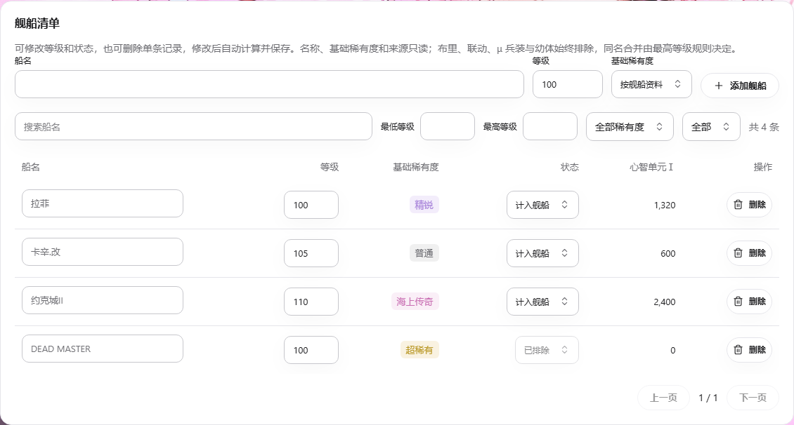

# 心智单元计算器

> 在 AP 内扫描船坞、核对舰船清单，并计算升至 120 级所需的心智单元Ⅰ与物资。

## 1. 模块概述

实例的「舰队管理 → 心智单元计算器」打开 `/i/:instance/task/MindCalculator`，与「舰队信息」并列。
旧 `/i/:instance/mind-calculator` 链接自动跳转到新入口；侧栏树、桌面悬浮菜单和顶栏任务跳转共用 WebUI 导航项，计算器不注册为可执行游戏任务。
用户可以手工录入、导入 JSON / CSV / Excel、导入船坞截图，或运行 `MindCalculatorScan` 自动任务。
名单身份、等级与基础稀有度均确认的舰船直接纳入计算；不确定的结果保留待核对状态。
布里、联动舰船可识别并保存，但归入已排除，不产生心智费用。

实现参考心智单元计算器 v0.32.43 还原工程的 `Calculator.cs`、`OcrService.cs` 和 `AutoScanService.cs`，
在 Python / React 中独立实现，并复用 AP 的设备、OCR、船坞导航和任务恢复机制。
公共舰船资料直接复用 `assets/ship/ship_data.json`，由现有 Lua 提取器维护，不再保存独立的计算器目录。

## 2. 模块职责

### 负责

- 按实例保存舰船清单、核对状态、排除状态与数据版本。
- 定位船坞卡片，重读船名及等级，按跨屏位置合并卡片。
- 按基础稀有度计算剩余觉醒材料，按基础舰船身份取最高等级。
- 提供五种界面语言、待核对舰名校正、等级与状态编辑、单条删除、组合筛选分页及文件导入导出。

### 不负责

不执行觉醒、强化或退役，不推算升级经验，不统计 120→125 级的心智单元Ⅱ。
不调用原 WPF / WebView2 程序，不接入原工具的云 OCR 或同步账号。

## 3. 模块位置

| 位置 | 职责 |
| --- | --- |
| `module/runtime/mind_calculator.py` | 舰船资料、身份归并、费用计算 |
| `module/runtime/mind_recognition.py` | 卡片定位、多轮 OCR、跨页合并 |
| `module/retire/mind_scan.py` | 自动船坞扫描任务 |
| `module/api/mind_calculator_service.py` | 实例保存、导入、识别与导出 |
| `assets/ship/ship_data.json` | 共享舰船属性、基础身份与改造名称 |
| `frontend/src/pages/MindCalculator.tsx` | 页面、草稿、核对和任务入口 |
| `frontend/src/mind/` | 类型、翻译和布局 |

## 4. 核心入口

| 入口 | 用途 |
| --- | --- |
| `alas.py::mind_calculator_scan()` | 调度任务派发 |
| `MindCalculatorScan.run()` | 重置筛选、回顶、扫描和保存 |
| `recognize_cards()` | 截图归一化后识别三行，返回位置、等级可靠性和可编辑字段 |
| `calculate()` | 无设备依赖的费用计算 |
| `mind.report / mind.calculate / mind.catalog` | 已保存结果、草稿预览和公共资料 |
| `mind.save / mind.import / mind.recognize / mind.export` | 保存、文件互通、截图识别和导出 |

## 5. 核心组件

`Card` 包含列、屏幕坐标、可编辑舰船字段及识别质量。
`ScanMerger` 从相邻截图的重叠区域核验正负滚动距离，映射绝对行坐标后按位置选择较好的读数。
中间截图仅通过 `advance()` 累计位移；两次整页 OCR 相隔三排时，不要求这两张截图直接重叠。
位移比较先抽取既有采样列，再转为连续浮点数组；逐像素误差、全部候选位移与歧义拒绝阈值保持一致。
内部保留各船位核验排序和重叠；输出清单与批量截图导入按基础身份取最高等级，后遇到更高等级替换整条记录。
改造前后属于同一身份，等级相同时优先保留改造条目；II 型及 META 保留独立身份，不去掉 II 后缀。
陌生名字不推测改造关系，占位名称不合并。

舰船持久字段为 `name / level / rarity / base_rarity / excluded / review / source / group_type / candidates`。
目录保留同名多值索引，展示名仍为游戏名称；确认群组贯穿扫描、计费、人工选择、草稿、保存与文件互通。
同名不同群组分别计算，同群组副本取最高等级，同级优先改造。目录选择项以舰种和阵营区分同名身份。
自动扫描从第一轮就按游戏阵营按钮分别扫描，每轮使用对应阵营的 Lua 目录。
跨阵营同名不会进入同一候选集；重樱的加贺、天城仍用正向航空/炮舰图标区分舰种。
名称未确认时按阵营内字面相似度选择，最高分附近的候选优先匹配舰种和稀有度，同分按共享 Lua 资料首次出现的群组顺序选择。
回填来源明确标注“自动回填”，不要求人工确认后才计费；这是一项偏重速度与连续运行的自动估算策略。
“其他”按 Lua 包含联动、布里等目录身份，识别后沿用自动排除计费规则，不将它当成某一个联动国籍。
用户取消仍立即退出，不继续输入或提交。正常结束尝试恢复全阵营筛选；恢复失败不丢弃已读结果。
旧无群组记录仅在身份唯一时补全；同名歧义保持独立核对和原始读数，保留人工排除，不在只读报告中写盘。
旧人工排除若缺少唯一身份，重复扫描保留原排除记录；新确认的候选身份暂不恢复收费，等待用户明确计入。
兼容上一版明确带舰种或阵营限定的名称，只按资料能证明的唯一身份补全群组，不随意剥离括号。
等级未确认以 `level=0, review=true` 保留，界面显示“未知”；0 只表示未知，不是正常舰船等级，不参与计费。
待核对卡位分别保留，不按未确认的同名身份合并，也不覆盖已确认条目。`source` 保留卡位、原因和异常原帧路径。
`revision` 是保存的舰船数组的 SHA-256，用来拒绝过期覆盖。

## 6. 工作流程

手工录入或文件导入 → 草稿计算 → 保存 → 导出。新增时默认使用资料稀有度，也可显式指定基础稀有度。
正常清单的名称、基础稀有度和来源只读；待核对行显示实际 OCR 读数，可从资料选择完整舰名，也可手动修改基础稀有度。
等级在失焦或回车提交有效整数（1–125）后自动计算并保存。校正名称、等级或基础稀有度仍保持待核对，人工选择计入舰船后才计费。
状态可切换为计入舰船、待核对或已排除，分别更新持久字段 `excluded / review`；删除按钮只移除对应原始行。
待核对舰名、等级、基础稀有度、状态与删除复用防抖计算及自动保存，保存期间禁止重复操作，保留当前分页并限制到有效页码。
名称、等级范围（包含上下边界）、基础稀有度及状态可以联合筛选，只影响展示，不改变总额、扫描范围或保存清单。
布里、联动、μ 兵装和幼体的自动排除状态不可切回计费；缺少有效等级或基础稀有度不能通过切换状态计费。
同群组合并由最高等级及同级优先改造规则派生；排除或删除其中一行后重新计算其余有效行。
无效等级回到原值；保存失败保留草稿和具体错误，版本冲突不自动覆盖或循环重试。
提交后切换实例，成功响应仍清除本次对应的旧草稿；不会清除后来编辑的新草稿。

自动任务：进入 `page_dock` → 重置筛选、确认等级降序 → 按阵营核实筛选按钮 →
扫描该阵营 → 合并各阵营结果 → 比较旧数据版本 → 事务保存。没有全阵营首扫或扫描后的整阵营复扫。
固定顺序是白鹰、皇家、重樱、铁血、东煌、撒丁帝国、北方联合、自由鸢尾、维希教廷、郁金王国、晶环联盟、META、飓风、其他。

每个阵营采用截图、识别、操作循环，不使用固定休眠。关闭筛选后不接受通用加载器的一帧空船坞结论，
空状态必须在新截图中连续确认至少 1.2 秒。回顶最多两次；仍未确认时记录覆盖提示，继续读取当前卡片。
只读取船名、等级完整可见的行，按七列网格逐卡识别。单次 190 像素触控拖动后重新截图，保留页面重叠；
取消三排精确定位及最多八次微调。实际位移仍优先用原图和滑块证据确认，失败时按群组合并当前页并继续，不把触控距离冒充实测位移。
该模式将稳定观察窗缩短为 0.25 秒、拖动结束按住时间缩短为 0.12 秒，均继续获取新帧确认画面。

名称每卡首读后直接匹配当前阵营；不做逐卡相位穷举、II 多尺度复读或整页名称复读。
无法唯一匹配时使用上述 Lua 目录回填。稀有度与基础稀有度来自选中的 Lua 身份，费用仍按基础稀有度计算。
等级优先使用原生 Lv/数字模板，失败后只保留原色及白字两路 OCR，两个读数一致且位数符合时接受。
未知等级仍以 `level=0, review=true` 保留，不凭舰船资料虚构等级，也不阻塞后续页面。
原始 OCR 候选保留在卡片对象中，回填计数记录为 `name_catalog_fallback`。

读图失败在当前页重试一次，然后翻页继续；连续三页仍不可读则保留已读结果并继续下一阵营。
画面持续 12 秒不可读、单阵营达到 500 页、筛选或局部识别异常都只结束当前阵营。
未完成的阵营合并其原有范围内记录，已完成阵营采用本轮结果，之后按群组取最高等级并保留人工排除。
连续两次翻页后画面不变时结束当前阵营；只有实际底部证据才能标记真实到底，否则保留旧记录并记录覆盖警告。
早停仍需完整三排普通舰、可靠等级及降序证据，全部低于下限；范围包含上下边界。

完整 1–125 扫描中的数量校验仅作提示，不再因计数差异、未知容量或局部覆盖疑点拒绝整次保存。
物理卡位数与按群组合并后的舰船数分别记录；船坞容量按游戏规则不含国籍 97 的 META。
数量读取共用严格的 `ScanDockAmount`，拒绝额外字符和越界分子，不把识别结果裁成容量。
舰船科技仍沿用独立的严格扫描与缺失证明规则，不能套用心智的自动回填、近似计数和局部继续策略。

任务仍保护设备物理互斥、指定设备恢复范围、人工排除和保存版本。取消不提交，版本冲突不覆盖人工编辑。
设备断开、用户接管或初始化无法提供目录/识别引擎时沿用工具级错误处理；局部识别失败不触发游戏重启。
上传截图及人工输入继续使用严格身份查询和有限复读，不采用自动扫描的阵营内强制回填。

## 7. 调用关系

### 上游

React 页面经 `/api/v1/ws` 请求 API；手动工具任务经运行时调用 `alas` 方法。

### 下游

使用 `Dock` 导航、筛选、降序切换及 `DOCK_SCROLL`，使用设备现有截图与拖拽能力。
扫描任务直接核验滚动条像素端点，不修改舰队管理共用的滚动条或扫描器。
使用 `AlOcr` 的 PP-OCRv6、等级识别接口和现有 OCR 工作队列，不另建模型下载系统。
Excel 由锁定的 `openpyxl` 依赖读写。

## 8. 数据流

截图 → 内存卡片与位移 → 可编辑舰船数组 → 实例配置 → 费用报表 → 浏览器或导出文件。
置顶编队页和局部复核页保留原帧及最终卡位 JSON，普通正常页不写图；不保存 OCR 模型或设备配置。
已知舰船的基础稀有度默认使用资料；手工新增或清单导入明确指定的基础稀有度保留到保存、重载与导出。
截图识别不以卡框猜测改造基础稀有度；缺少可靠资料时保留核对状态。

## 9. 状态模型

每行计算状态为 `included / merged / review / excluded`，额外返回只读的 `automatic_excluded` 标记；自动排除条目不能切换为计费。
`automatic_excluded`、状态、费用及资料补全字段不写入清单，保存只使用上述持久字段。
手工排除优先于核对；自动排除舰船若存在未确认读数仍显示待核对，核实后可选择排除，始终不能计费。
待核对、未读到等级或缺少基础稀有度时不计费。
同基础身份只保留有效清单中最高等级的一行，其余行标为合并。
META 保留独立身份；共享资料 `nationality=98` 的三种布里（泛用型、试作型 MKII、特装型 MKIII）、联动、μ兵装与幼体舰船自动排除，仍可在排除筛选中查看。布里分类只在计算器目录构建时派生，不改共享资料或舰队识别器。

## 10. 配置

`MindCalculatorScan.MindCalculator.Result` 是隐藏的 `stored` 配置，默认 `{}`，
内容为 `ships` 和 `updated_at`。仅保存本实例数据，配置生成器维护对应模板与类型。
`MindCalculatorScan.MindCalculator.MinLevel / MaxLevel` 默认 95 / 125，可设 1–125 且下限不大于上限。
计算器页面经 `config.patch` 保存范围后才调用 `tasks.run`；国服实例标识兼容 `cn` 与 `cn_android-*` 等 `cn_` 前缀。
自动任务使用实例现有 OCR 配置；上传截图接口使用默认 ONNX / CPU 设置，不读取私人云配置。
两条路径创建的 `AlOcr` 均设置 `save_debug_images=False`，避免每张字图写盘及整理目录。
此选项属于识别器实例，不参与模型缓存；其他任务沿用原来的调试图默认行为。
等级重读、身份冲突提示及任务异常截图保留。离线诊断可向 `recognize_cards()` 显式传入
`AlOcr(..., save_debug_images=True)`，不需要修改全局模型或用户配置。
稳定画面比较使用原有完整灰度签名的平均绝对差，阈值仍为大于 1；由 OpenCV 直接处理字节数组，
避免整帧浮点临时分配，不减少截图、比较像素或稳定等待条件。

## 11. 异常与错误处理

输入文件、分辨率或字段错误返回 `INVALID_PARAMS`；旧版本保存返回 `CONFLICT`。
上传允许 PNG / JPEG / WebP，处理 EXIF 方向、可确认的成对黑边及完整 16:9 游戏区域，复用设备截图缩放到 1280×720。
非船坞、全黑、不完整比例、损坏文件和超限图片分别返回原因，OCR 引擎失败返回 `OCR_UNAVAILABLE`。
批量上传按文件显示进度；坏文件提示文件名和原因，已成功识别的文件仍进入草稿。
船坞无法回顶、卡片无法定位、相邻截图无法对齐或三排定位不确定时抛出 `MindCalculatorScanError`，要求人工接管，旧结果保持可用。
任务运行器记录具体原因、完整异常与错误截图，结束本次工具任务并保留旧清单；识别失败不触发模拟器重启。
画面长时间不再滚动或达到页数上限但未确认到底时抛出 `GameStuckError`，沿用上层恢复。
稳定等待或页面丢失超过 30 秒抛出 `MindCalculatorScanError`；期限检查覆盖动画、等待与弹窗分支。
已核实新页并新增物理船位后重新计量滚动期限，避免把有界 OCR 复读的耗时算作下一段滚动停滞；重复旧船位不能续期，零位移与缺页保护仍有效。
无进展检查位于循环前部；定位仍限制最多八次拖动，卡位数与页数保留原有上限，不能以触控距离或缺卡证明到底。
局部识别错误作为核对项随完整扫描一次保存。用户停止、设备或模型异常、布局/位移无法确认仍不提交半份结果，保留旧清单。
识别器初始化或逐页扫描发生 `MemoryError` 时，转为 `MindCalculatorScanError`，报告内存不足并保留旧清单，
避免将主机内存不足当作游戏故障进入通用重启恢复。

## 12. 并发与线程模型

API 业务沿用 WebSocket 工作线程，OCR 沿用现有队列。
自动扫描和上传使用每个识别器独占的有界字图缓存，只复用形状、类型及所有字节完全相同的输入；
每个缓存最多 256 项、4 MiB，OCR 设置变化清空缓存，诊断写图模式沿用原路径。没有增加后台推理线程。
停止、异常或超时不提交半份结果；模型运行异常转为扫描失败，不进入通用游戏重启。
API 保存和游戏工作进程共用实例配置事务锁，锁内重读并比较舰船版本。
扫描途中用户保存不同舰船数据时，任务拒绝覆盖并提示重新扫描。

## 13. 缓存与持久化

公共资料按进程缓存；文件更新后重启服务加载。
舰船清单原子写入实例配置；原工具私人配置和用户下载路径不会进入内置资源。
前端将未保存草稿与原版本存入按实例区分的 `sessionStorage`，重载或导航后可恢复。
恢复的过期草稿仍受保存版本校验；重新载入会明确丢弃草稿。

## 14. 生命周期

计算器页面加载公共资料与本实例清单，编辑后防抖计算，每五秒读取保存结果。
有未保存草稿时轮询不覆盖编辑。实例路由切换重新挂载页面，响应不会写入其他实例。
编辑或删除后的报表必须与对应输入快照匹配，不能在新清单索引上显示旧行的状态或费用。
自动任务仅在用户启动时连接设备，确认完成后一次保存，停止操作复用任务运行器。
扫描页数、累计读取船位数和同名归并后的范围内数量记录到 `[心智扫描]` 日志，页面读取任务日志显示进度。

「自动扫描船坞」要求连接可用、数据已加载、草稿已保存，且当前实例没有任务运行或更新。
禁用时按钮下方直接显示当前阻塞原因，扫描期间提供「停止扫描」。
游戏地区使用实例列表中的 `region`，由后端按 `Emulator.PackageName` 和现有 `to_server()` 规则解析。
`Emulator.ServerName` 是可关闭的开服检测配置，不能用来判断是否国服。
包名为 `auto` 时地区暂为 `null`，允许启动，由设备检测实际包名后执行任务中的国服校验。

## 15. 扩展方式

更新资料运行 `uv run python -m dev_tools.ship_data_extractor --lua-repo <Lua 仓库路径>`，
统一生成 `assets/ship/ship_data.json`。改造名称从 `skin_type=2` 的皮肤表提取，写入基础舰船的 `retrofit_names`。
计算器运行时按群组合并突破阶段，排除无舰船模板及复制身份的剧情记录；改造关系保留基础稀有度，II 型与 META 保持独立身份。
幼体分类由 Lua 的 `Little-series` 标签生成 `is_child`，不按「小」字前缀判断，避免排除小猎兔犬与小天鹅。
目录没有独立更新时间，接口的 `updated_at` 返回空字符串；更新共享文件后重启服务加载。
共享资料只有剧情记录、缺少可获取身份的舰船保留待核对，不使用剧情模板自动计费。
支持其他游戏服务器前，应增加对应语言舰船资料与截图回归；不能只解除国服检查。
调整 API 参数时重新生成契约；调整配置源时重新运行配置生成器并补齐五语言文案。

## 16. 修改注意事项

费用阶梯按已越过的觉醒门槛推断：≤100 未越过，101–105 越过一次，106–110 两次，111–115 三次，116 起四次。
等级停在 100、105、110、115 时可能已经觉醒，但截图不能证明，按该等级尚未越过门槛计算。
四阶心智费用为 N `60/120/180/300`、R `80/160/240/400`、SR `120/240/360/600`、
SSR `200/400/600/1000`、UR `300/600/900/1500`；物资为心智费用的十倍。
改造按基础稀有度，不以画面升档后的卡框直接计费。

上传原文件限制 5.5 MB，舰船最多 5000 行，Excel 解压内容最多 32 MiB。
WebSocket 仅计算器文件及清单方法允许扩展到 8 MiB，其他业务仍保持 1 MiB。
`gui.py` 的 Uvicorn 帧上限必须同步为 8 MiB，否则 Base64 图片会在进入 API 前被 1009 断开；mock 服务使用相同限制。
Excel 文本不执行公式；CSV 导出对公式起始字符加文本前缀。

## 17. 已知限制

自动扫描目前支持国服标准船坞，设备沿用 AP 的 1280×720 识别坐标。手动截图支持完整 16:9 画面的等比缩放和成对纯黑边，
不自动识别任意桌面窗口边框或被裁掉的游戏内容；七列位置沿用 AP 标定。
原工具自动采集按 2560×1440 标定，不能直接复用原尺寸参数。
这是原生迁移，未复刻原工具全部特例：无云 OCR、舰种图标判别、原 Excel 截图缩略图和全套多种位移种子选优。
截图批量导入和自动扫描均对同群组取最高等级；自动扫描额外核验跨屏位置和排序。
可靠结果直接计算；单字舰名、低清晰度图片与多轮读数冲突仍需核实，不确定结果不计费。
待核对行可从资料选择舰名，也可修改基础稀有度；正常行身份只读。状态切换代表人工明确核对，校正名称、等级或基础稀有度不会自动清除核对标记。个别截图通过不代表所有实例的全名单准确率。

## 18. 示例

清单控件修改前（用户提供的需求截图）：

修改后（隔离浏览器测试数据，展示等级/稀有度筛选、状态选择与单条删除）：

未知等级清单的页面对照：基线显示 0 且名称只读；恢复后显示“未知”，待核对名称可校正，基础稀有度可手动选择。恢复后的示例演示已将未知条目基础稀有度设为精锐，仍保持待核对且不计费。

拉菲 100 与拉菲.改 106 合并后按 106 级、基础 SR 计费，剩余 `360 + 600 = 960` 心智单元Ⅰ。
125 级不再产生目标 120 级的费用。等级未读到或仍待核对时显示核对状态，不计入总额。
JSON 为带 `ships` 数组的对象或数组；CSV / Excel 按“船名”和“等级”表头定位。
原工具 Excel 的明细第二行表头、存疑状态和右侧排除船名区均可回读。

## 19. 调试方法

运行 `uv run python -m unittest tests.test_mind_calculator tests.test_mind_scan tests.test_fleet_ship_names tests.test_fleet_emotion`。
离线夹具覆盖真实船名、META、截断名、等级与核对状态；模拟图覆盖漏百位、跨屏合并和无重叠拒绝。
三行夹具覆盖编队置顶、范围边界、同名多艘、缩放与黑边；传输回归使用真实 Uvicorn，覆盖大图片上传与普通请求限额。
模拟图另覆盖第三排、灰色卡面误判、三排累计位移、动画停稳、反向过冲校正、末页及无重叠拒绝。
独立实机等级裁剪保留未参与模板提取的验证页。
`mind_names.png / json` 仅保留实机名称条与人工标签，覆盖 II 后缀和形近字，并校验与舰队扫描预处理完全一致。
`mind_names_second_types.png / json` 保留约克城 II、列克星敦 II 以及实际失败原帧的北安普敦 II 名称条，
验证不平滑放大后的后缀与已核实的 `ⅡI` 误读；不把单个 I 直接改为 II。
首读和既有复读仍未确认原舰/II 型家族时，增加两张最近邻放大字图，沿用原投票和歧义拒绝规则；
不把单个 I 自动补成 II。自动扫描仍未确认时重新截图，最多读取三帧，仍失败标记该卡位待核对并继续。
`uv run python -m unittest tests.test_scheduler_recovery` 验证识别失败保留具体原因且不重启模拟器。
浏览器流程在 `frontend` 目录运行 `npx playwright test --config playwright.mind.config.ts`，
模拟服务使用 `dev_tools.mind_calculator_mock.py` 调用真实算法，不连接任何设备。
浏览器回归还覆盖开服检测关闭时启动扫描、草稿保存后解除禁用、扫描停止、地区与运行/更新状态提示，
以及等级/状态/删除自动保存、冲突保留草稿、正常身份只读、待核对名称校正、未知等级与重复核对项保存、组合筛选、分页、改造身份归并、II 型独立和布里/联动排除。
`mind-navigation.spec.ts` 验证舰队管理下两个并列入口、旧链接跳转及舰队信息扫描开关的启停、完成后刷新和其他任务/更新时禁用；开关只启动 `FleetScan` 工具，不写实例自启设置。
查看任务日志中的“扫描页”“识别卡片”“船坞位置”，并检查舰船来源中的重读提示。
“本页编队”保留各卡位的编号；“扫描核对原帧”及重读原因用于定位累计排序不能确认的首个位置。
“早停检查”说明拒绝提前结束的证据；底部退出记录滚动条像素端点。“心智扫描源码”记录实际模块路径及 SHA-256，
“本页识别摘要”包含完整舰船字段、编队与等级可靠性，便于连续扫描时及时发现差异。

合成纹理和 `ImmediateTimer` 控制流程测试不能代表实机截图、拖动或稳定等待时间；实机端到端速度需另行授权验收。
`uv run python -m unittest tests.test_mind_scan_stuck` 回放原帧瑞凤徽标与蓝卡反例，使用真实 `ScanPolicy`、
`ScanMerger`、真实 `Timer` 和虚拟单调时钟验证新帧纠错后早停、疑点保留后到底、持续动画、页面丢失、无位移与假底部。
`mind_fleet_six.png` 保留同一 Z20 编队徽标的两种实机采样相位，复现首个过线模板将 6 记为 1，并验证候选排序及歧义拒绝。
`mind_names_stuck.png / json` 保留两种实机采样相位的白凤与乌尔里希名称条，验证形近字、图像双点、唯一补全及无图像证据时的拒绝。
`mind_yorktown_phase.png` 保留约克城 II 被读成单个 I 的实机名称条；出现未确认罗马后缀时，
即使其他复读暂命中基础型，也补读名称区下移两像素后的两张字图。仍要求两次真实 II 读数，未确认后缀不能默认为基础型。
`mind_matsubream_phase.png` 保留松鲷被卡框残影干扰的两种采样相位，验证短名原色去边后的双读确认，不新增猜测名称映射。
`mind_shizuku_phase.png` 保留雫的实际失败字图，验证单字名缩边双读及冲突拒绝。
`mind_ryujo_phase.png` 回放龙骧的固定形近字误读；`mind_retrofit_punctuation.png` 回放华甲改造标点丢失，核验已确认的目录别名，同时拒绝普通/改造或其他舰船的冲突读数。
`mind_rarity_phase.png` 回放紫框同时满足 SR/R 颜色条件的实图；仅在卡框分类中剔除重复计数，原阈值及普通蓝框反例保持约束。
实机对照固定范围、资料和实际 OCR 后端，记录新工作进程与源码摘要，以扫描入口至「已保存」日志计时。
核对 API 与落盘清单时验证原始清单的 revision 和更新时间；报告行会补全资料、费用和状态，不能直接与原始清单字典比较。
多轮结果需核对全部清单、状态和费用，并保留来源提示的差异；轮询观察到停止的时间包含额外延迟。
本次复现、版本摘要、离线检查和实机验收见[修复验证记录](mind-scan-verification.md)。
Lua 名单相似度补全、META 前缀及航空图标区分的证据见[舰名补全验证](mind-lua-name-verification.md)。

## 20. 相关模块

[API](api.md)、[运行时](runtime.md)、[前端](frontend.md)、[OCR](../ocr.md)、
[退役与船坞](../game/retire-equipment.md)、[配置](../config.md)。

## 舰队科技的兼容导入

舰队管理下的[舰队科技列表](fleet-technology.md) 使用独立 `FleetTechScan` 任务，两个任务共用群组消歧机制，各自保持目录、范围和结果。
科技页面主动导入心智已确认群组时仍验证名称一致性；拒绝伪造或矛盾群组，计费排除不阻止获得证据导入，歧义旧名不猜群组。

旧版 `MindCalculatorScan.MindCalculator.FleetTechRecord` 只读兼容，首次科技编辑或扫描时复制到 `FleetTechScan.FleetTech.Record`，保留旧数据作为迁移备份。心智扫描或清单保存不再自动修改科技记录；新科技任务的记录、快捷等级切换及范围保护见对应文档。
